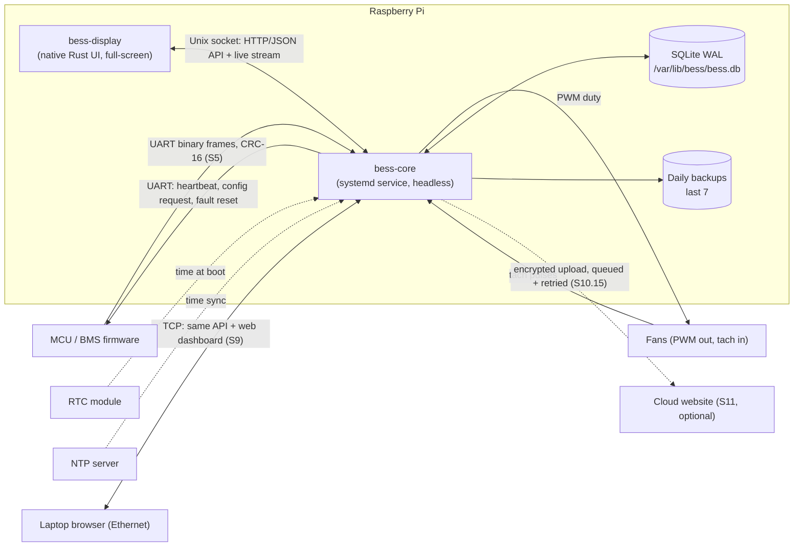
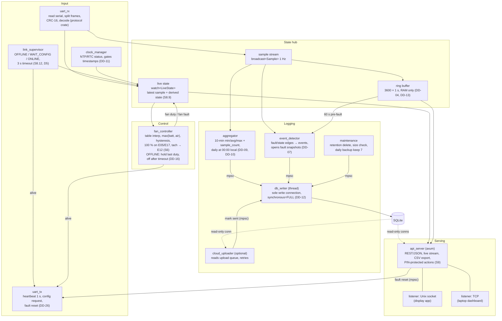

# D1 – Pi software architecture

Status: **Agreed 2026-10-27** (open points below). Follows DD-02 (core service + display app) and DD-03 (native Rust UI). Decisions made in this discussion go into [decisions.md](decisions.md).

## 1. Processes and external interfaces

## 2. Inside bess-core

Boxes are async tasks (tokio) unless marked *thread*. Arrows are channels: `watch` = latest value only, `broadcast` = every sample to each listener, `mpsc` = work queue to a single owner.

## 3. Proposed crate layout (Cargo workspace in `Pi/`)

| Crate | Kind | Contents |
|---|---|---|
| `protocol` | lib | Frame types, CRC-16, decoder; tested against C reference frames (S5). Shared with `/protocol` spec. |
| `bess-api` | lib | Serde types for the HTTP/JSON API and live stream (used by core, display and dashboard tests). |
| `bess-core` | bin | All tasks above. |
| `bess-display` | bin | Native touchscreen UI; only talks to `bess-api` over the Unix socket. |

## 4. Decisions

Agreed 2026-10-27, see [decisions.md](decisions.md):

- DD-14 One API (axum) for display (Unix socket) and laptop dashboard (TCP).
- DD-15 Single `db_writer` thread; read-only connections for readers.
- DD-16 On comm loss the fans hold their last duty; off if the link does not recover within `FAN_OFFLINE_TIMEOUT` (value open).
- DD-17 `panic = "abort"` + systemd restart/watchdog. Fan behaviour while the core is down: open (D10, fan controller hardware not chosen yet).
- DD-18 Live data via Server-Sent Events.
- DD-19 Display toolkit: Slint.

Open: `FAN_OFFLINE_TIMEOUT` value, fan controller hardware and S6 hardware fallback (D10).
