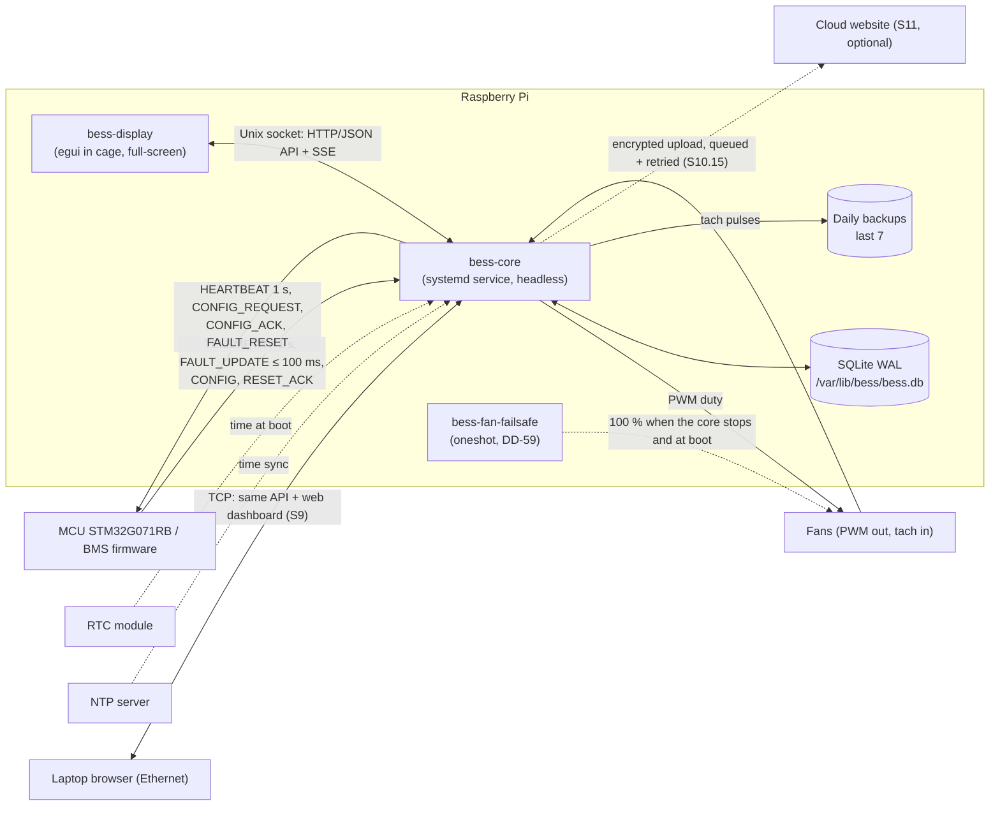
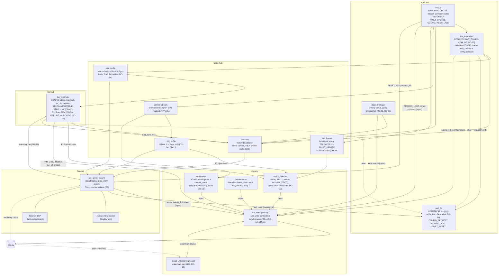

# D1 – Pi software architecture

Status: **Agreed 2026-10-27**, revised the same day for the firmware UART draft (DD-40, [decisions.md](decisions.md)); **in review since 2026-10-29**: DD-70 proposed (D8 sweep: a decision in this document that had no DD), DD-71 (repository layout per S1.3) agreed and the same day proposed again with a fifth crate `bess-fan-failsafe` (DD-59), and section 2 completed with the channels other documents rely on (writers to `db_writer`, E12 to `event_detector`, fan re-enable, RESET_ACK); open points below. On 2026-11-02 DD-19 dropped Slint and DD-87 proposed egui in the cage compositor. Follows DD-02 (core service + display app) and DD-03 (native Rust UI).

## 1. Processes and external interfaces

UART: 115200 8N1, binary frames `AA 55`, protocol version 0x03, CRC-16/CCITT-FALSE (UART draft V2, DD-40).

## 2. Inside bess-core

Boxes are async tasks (tokio) unless marked *thread*. Arrows are channels: `watch` = latest value only, `broadcast` = every sample to each listener, `mpsc` = work queue to a single owner. Tasks share state only through these channels (DD-70).

`uart_tx` is the only writer to the serial port (DD-70); `link_supervisor` and `api_server` send it messages. RESET_ACK goes from `uart_rx` back to the waiting `api_server` request (matched by `request_id`, 2 s timeout, DD-38).

Every task that logs an event or changes `core_state` sends it to `db_writer` (DD-15): besides the logging tasks, `uart_rx` (`FRAMES_LOST` and the communication counters, DD-66, S5.9), `clock_manager` (`TIME_INVALID`, `TIME_ADJUSTED`), `fan_controller` (`FAN_CTRL_RESET`, the `fan_off` state of DD-85) and `api_server` (`FAULT_RESET`, `PIN_LOCK`, `FAN_REENABLED`, PIN state). `fan_controller` hands E12 raise and clear to `event_detector`, which logs it like an MCU code (DD-34, DD-39).

## 3. Proposed crate layout (Cargo workspace in `monitor/`)

| Crate | Kind | Contents |
|---|---|---|
| `protocol` | lib | Frame envelope, CRC-16/CCITT-FALSE, encoder + decoder for all UART draft messages, CONFIG validation; tested against the draft's reference frames and C-generated frames (S5.11, DD-40). Shared with the `/protocol` spec. |
| `bess-api` | lib | Serde types for the HTTP/JSON API and live stream (used by core, display and dashboard tests). |
| `bess-core` | bin | All tasks above. |
| `bess-display` | bin | Native touchscreen UI; only talks to `bess-api` over the Unix socket. |
| `bess-fan-failsafe` | bin | Small separate program that writes 100 % to both fan controllers over I2C and exits; run by systemd from `ExecStopPost=` of `bess-core` and from an early boot unit (DD-59, [fan-hardware.md](fan-hardware.md) §4). |

Repository layout (DD-71; agreed 2026-10-29, proposed again the same day with the `bess-fan-failsafe` crate) follows S1.3: `/monitor` (this workspace, renamed from `Pi/` on 2026-10-29), `/protocol` (UART specification, the one document for C and Rust, S5.10, with reference frames and the CONFIG validation list), `/firmware` (C, MCU) and `/docs`. `/protocol` and `/firmware` are filled once the firmware team agrees to work in this repository; until then the UART specification stays their draft in `Research/`.

## 4. Decisions

See [decisions.md](decisions.md):

- DD-14 One API (axum) for display (Unix socket) and laptop dashboard (TCP).
- DD-15 Single `db_writer` thread; read-only connections for readers.
- DD-16 Fan behaviour on comm loss from CONFIG `fan_offline_action` / `fan_offline_ms` (revised, UART draft).
- DD-17 `panic = "abort"` + systemd restart/watchdog; a dead core stops the heartbeat → MCU E11, charging off.
- DD-18 Live data via Server-Sent Events.
- DD-19 (revised 2026-11-02) Touchscreen UI only from free, open-source software with a permissive licence; Slint dropped.
- DD-26 / DD-27 `uart_tx` and link states (from D5, revised for the UART draft).
- DD-40 `protocol` crate implements the UART draft.
- DD-42 E-STOP → fans off.

Proposed 2026-10-29:

- DD-70 (D8 sweep) Tokio tasks plus the `db_writer` thread; state shared only through `watch` / `broadcast` / `mpsc` channels; `uart_tx` is the only serial writer.
- DD-71 Repository per S1.3: `/monitor`, `/protocol`, `/firmware`, `/docs` (section 3). Agreed 2026-10-29, proposed again the same day: the workspace gets a fifth crate `bess-fan-failsafe` (DD-59).

Proposed 2026-11-02:

- DD-87 Toolkit: egui/eframe + `egui_plot` inside the cage kiosk compositor; `cargo-deny` and `cargo-about` in CI; to check on the Pi 4 touchscreen.

Open: SoH method (D9). Fan controller hardware and core-down fallback proposed in D10 ([fan-hardware.md](fan-hardware.md), DD-56 to DD-61).
