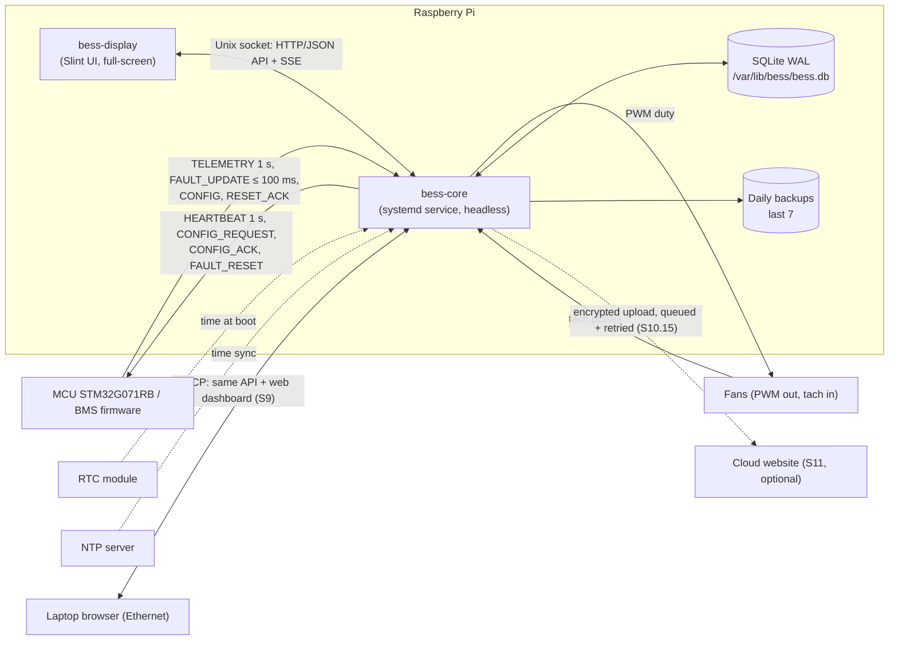
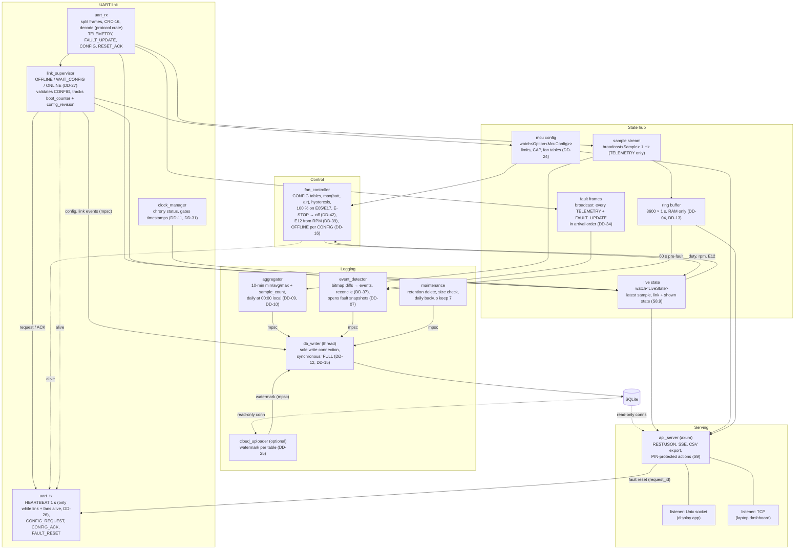

# D1 – Pi software architecture

Status: **Agreed 2026-10-27**, revised the same day for the firmware UART draft (DD-40, [decisions.md](decisions.md)); open points below. Follows DD-02 (core service + display app) and DD-03 (native Rust UI).

## 1. Processes and external interfaces

UART: 115200 8N1, binary frames `AA 55`, protocol version 0x02, CRC-16/CCITT-FALSE (UART draft, DD-40).

## 2. Inside bess-core

Boxes are async tasks (tokio) unless marked *thread*. Arrows are channels: `watch` = latest value only, `broadcast` = every sample to each listener, `mpsc` = work queue to a single owner.

`uart_tx` is the only writer to the serial port; `link_supervisor` and `api_server` send it messages. RESET_ACK goes from `uart_rx` back to the waiting `api_server` request (matched by `request_id`, 2 s timeout, DD-38).

## 3. Proposed crate layout (Cargo workspace in `Pi/`)

| Crate | Kind | Contents |
|---|---|---|
| `protocol` | lib | Frame envelope, CRC-16/CCITT-FALSE, encoder + decoder for all UART draft messages, CONFIG validation; tested against the draft's reference frames and C-generated frames (S5.11, DD-40). Shared with the `/protocol` spec. |
| `bess-api` | lib | Serde types for the HTTP/JSON API and live stream (used by core, display and dashboard tests). |
| `bess-core` | bin | All tasks above. |
| `bess-display` | bin | Native touchscreen UI; only talks to `bess-api` over the Unix socket. |

## 4. Decisions

See [decisions.md](decisions.md):

- DD-14 One API (axum) for display (Unix socket) and laptop dashboard (TCP).
- DD-15 Single `db_writer` thread; read-only connections for readers.
- DD-16 Fan behaviour on comm loss from CONFIG `fan_offline_action` / `fan_offline_ms` (revised, UART draft).
- DD-17 `panic = "abort"` + systemd restart/watchdog; a dead core stops the heartbeat → MCU E11, charging off.
- DD-18 Live data via Server-Sent Events.
- DD-19 Display toolkit: Slint.
- DD-26 / DD-27 `uart_tx` and link states (from D5, revised for the UART draft).
- DD-40 `protocol` crate implements the UART draft.
- DD-42 E-STOP → fans off.

Open: fan controller hardware and fan behaviour while the core is down (D10); SoC and Ah/Wh source (D9).
