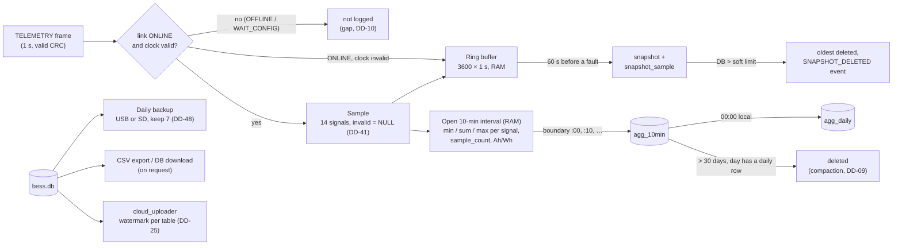
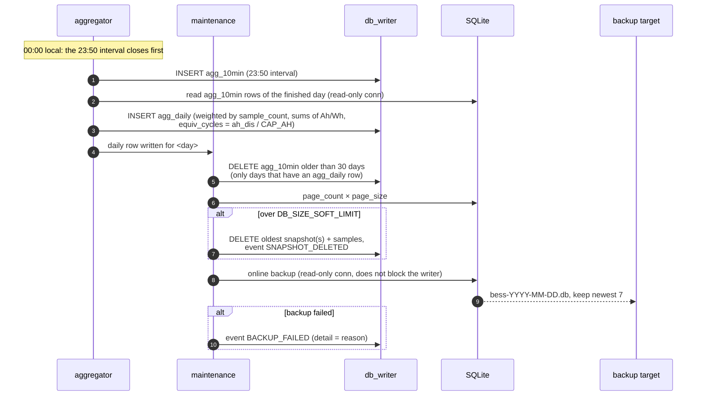
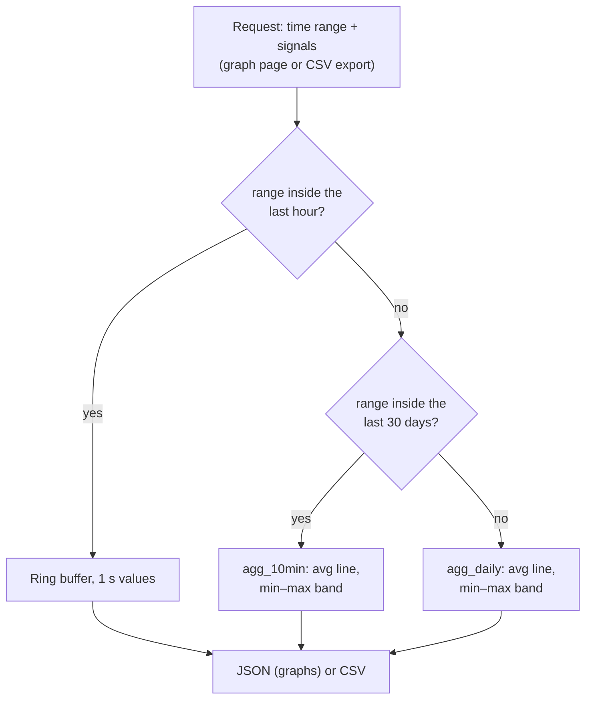

# D3 – Data lifecycle

Status: **Proposed 2026-10-28**, to be agreed (DD-45 to DD-50, [decisions.md](decisions.md)); open points in section 8. Builds on D1 ([architecture.md](architecture.md)): `aggregator`, `maintenance`, `db_writer`, `cloud_uploader`; D2 ([database.md](database.md)): tables and retention; D5 ([lifecycle.md](lifecycle.md)): link states, clock validity; D6 ([fault-handling.md](fault-handling.md)): events and snapshots. Decisions it relies on: DD-04 (storage tiers), DD-07 (two-stage snapshots), DD-08 (Pi integrates Ah/Wh), DD-09 (daily at 00:00 local), DD-10 (`sample_count`), DD-11 (no timestamps without a valid clock), DD-12 (WAL, `synchronous=FULL`), DD-13 (RAM buffer not persisted), DD-23 (retention), DD-25 (upload watermark), DD-41 (invalid fields NULL).

Requirements: S10.1 (SQLite WAL, power loss loses at most the last record), S10.2 (last 1 h of 1 s data in RAM), S10.3 (10-min min/avg/max + Ah/Wh), S10.4 (daily record at 00:00 local + equivalent cycles), S10.5 / S10.6 (events, ±60 s snapshot), S10.7 (retention: 10-min 30 days, daily and events ≥ 2 years), S10.8 (< 200 MB after 4 years), S10.11 (CSV export), S10.12 (DB download, scp), S10.13 (CSV opens in Excel), S10.14 (daily backup to a second location, keep last 7), S10.15 (optional cloud upload, queued, never blocks logging), S10.17 (gap after restart logged), S9 (graphs with time ranges and min–max bands).

## 1. Overview

One TELEMETRY frame a second turns into four kinds of stored data, each with its own lifetime:

| Tier | Resolution | Where | Lifetime | Written |
|---|---|---|---|---|
| Ring buffer | 1 s | RAM (3600 samples) | 1 h, lost on restart (DD-13) | Every sample |
| `agg_10min` | 10 min min/avg/max + Ah/Wh | SQLite | 30 days | At each 10-min boundary |
| `agg_daily` | 1 day min/avg/max + Ah/Wh + cycles | SQLite | Forever (≥ 2 years, S10.7) | 00:00 local |
| `snapshot_sample` | 1 s, ±60 s around a fault | SQLite | Until the size guard needs room | Two-stage (DD-07) |

Without a valid clock (DD-11) samples still go to the ring buffer with monotonic time, so live graphs work, but nothing is aggregated or written.

## 2. From frame to sample

- Only **TELEMETRY** frames make samples; FAULT_UPDATE frames go to `event_detector` only (D6 §2).
- Only while the link is **ONLINE** (D5 §2). In WAIT_CONFIG there is no CONFIG yet to interpret the values (S2.4); while OFFLINE there is nothing.
- The sample gets the Pi's **receive time** (UTC wall clock for storage, monotonic time for the ring buffer and timeouts).
- Conversion per D2 §1. A field whose validity bit is clear is `None` / NULL (DD-41). `fan_duty_pct` and `fan_rpm` come from `fan_controller` (D4), `power_w` = `pack_v × current_a` (NULL if either is NULL).

## 3. 10-minute aggregation (`aggregator`)

**Intervals** (DD-45): fixed 10-min intervals aligned to UTC `:00`, `:10`, … `:50`; the key `ts` is the UTC start (D2). For the Netherlands (UTC+1/+2) these are also local 10-min boundaries.

Per interval, held in RAM until the boundary:

- per signal: min, max, sum and count of valid values → avg = sum / count; a signal with no valid value in the interval is NULL in all three columns;
- `sample_count` = number of samples (frames), valid or not (DD-10);
- `ah_chg`, `ah_dis`, `wh_chg`, `wh_dis` (DD-46, refines DD-08): each sample with valid `current_a` counts for exactly one telemetry period (`telemetry_ms` from CONFIG, 1 s): `ah += |I| × t / 3600` into `chg` (I > 0) or `dis` (I < 0); Wh the same with `pack_v × I` (only when `pack_v` is valid too). Missing samples are not counted, so a gap is never filled with a guessed current. This does not depend on the wall clock, so NTP steps cannot add or remove charge.

**Writing:** the first sample at or after the boundary closes the interval; it is sent to `db_writer` as one `INSERT` and the new interval starts with that sample. If no sample arrives (OFFLINE), a timer closes the interval 2 s after the boundary. An interval with `sample_count` = 0 is not written: graphs show a gap (DD-10).

**Partial intervals:**

| Case | Result |
|---|---|
| Link lost or regained mid-interval | Row written with `sample_count` < 600 |
| Clean shutdown | Open interval written as a partial row (D5 §1) |
| Crash or power loss | Open interval lost (at most 10 min of aggregates, the "last record" of S10.1); `LOG_GAP` on next start |
| Restart within the same interval | Second row for the same `ts`: merged into the existing one (min of mins, max of maxes, sums and counts added, D5 §4) |
| Clock becomes valid mid-interval | First interval starts at the first timestamped sample (partial) |

## 4. Daily job (00:00 local)

`aggregator` and `maintenance` run one job after local midnight, in this order (DD-47):

- **Daily record** from the finished day's `agg_10min` rows with `ts` in `[ts_start, ts_end)`, where `ts_start` / `ts_end` are 00:00 local of that day and the next one in UTC, so DST days are 23 or 25 h (DD-09). Min of mins, max of maxes, avg weighted by `sample_count` (DD-10), Ah/Wh summed. `CAP_AH` = CONFIG `capacity_mAh` / 1000 of the running CONFIG, else of the newest `mcu_config` row; NULL if none exists.
- **Catch-up:** at core start and after the clock becomes valid, every finished local day within the last 30 days that has `agg_10min` rows but no `agg_daily` row is computed, so a Pi that was off at midnight still gets its daily records.
- **Compaction** (DD-09) deletes only 10-min rows whose day already has a daily row, so a failed daily job never loses data.
- **Size guard** (DD-23) also runs after each snapshot is completed, not only daily.

## 5. Backups (S10.12, S10.14)

DD-48:

- **Daily copy** with the SQLite online backup API from a read-only connection (WAL, the writer is not blocked), first to a temporary name, then renamed, so an interrupted copy is never mistaken for a backup.
- **Target:** a USB stick mounted at `backup_usb_path` (TOML) if present and writable, else `/var/lib/bess/backup/` on the SD card. The SD fallback does not protect against SD card failure; the System info page shows which target was used last.
- **Keep the newest 7** files on the target used; older ones are deleted after a successful copy.
- **On request:** "Download database" on the System info page (S10.12) runs the same backup into a temporary file and streams it; `scp` of the backup directory over Ethernet works without the app.
- Only a failure is logged (`BACKUP_FAILED`); the last successful backup time is kept in `core_state`.

## 6. Reading the data back (graphs and CSV)

`api_server` picks the tier from the requested range (DD-49):

- The user can choose a coarser resolution than the default (e.g. daily for the last week), never a finer one than exists.
- Gaps: points are returned with their `sample_count`; the graph breaks the line where an interval is missing (DD-10).
- **CSV** (S10.11, S10.13): UTF-8 (ASCII only in practice), comma-separated, `.` as decimal point, header row with units in the column names (`pack_v`, `t_cell_c`, … as in D2). First column `timestamp_utc` (ISO 8601, S10.10), second column `time_local` as `YYYY-MM-DD HH:MM:SS`, which Excel recognises as a date. Aggregates export `<signal>_min/_avg/_max` and `sample_count`. Streamed from a read-only connection, so a large export does not block logging.
- Snapshots are exported per fault from the fault log (1 s rows).

## 7. Cloud upload (S10.15, optional)

DD-50, extends DD-25:

- Off unless enabled in the TOML file (needs TE IT approval, P1.7). Credentials only in the TOML file / a key file, not in the source.
- `cloud_uploader` reads with its own read-only connection; it never writes except its watermark through `db_writer`, so it can never block or slow down logging (S10.15).
- Tables: `agg_10min`, `agg_daily`, `event`, `soh` and **complete snapshots** (`snapshot.complete` = 1 with their samples, S11.1). Watermark per table: last acknowledged `ts` or `id`. Events whose `cleared_ts` changed are re-sent by `id` (DD-25).
- Order per cycle: events first (S11.7, ≤ 30 s), then snapshots, then aggregates. Cycle every 10 s while there is something to send, exponential back-off up to 10 min while offline.
- If the cloud is unreachable for longer than the local retention, data that was already deleted locally is simply not sent; the website shows the gap.

## 8. Decisions

Proposed 2026-10-28, see [decisions.md](decisions.md):

| ID | Decision |
|---|---|
| DD-45 | 10-min intervals aligned to UTC `:00`/`:10`/…; the first sample at or after the boundary closes the interval (timer fallback 2 s); intervals without samples are not written. |
| DD-46 | Ah/Wh: each sample with a valid current counts for one `telemetry_ms`; missing samples are not counted; independent of the wall clock. Refines DD-08. |
| DD-47 | Daily job order: close 23:50 interval → daily record → compaction (only days with a daily row) → size guard → backup. Missing daily rows are caught up at start-up. |
| DD-48 | Daily online backup to USB stick if mounted, else SD card; keep newest 7; failures logged as `BACKUP_FAILED`. DB download uses the same mechanism. |
| DD-49 | Graphs and CSV read the tier that covers the range: ≤ 1 h ring buffer, ≤ 30 days `agg_10min`, older `agg_daily`; coarser on request. CSV with `timestamp_utc` + `time_local` columns. |
| DD-50 | Cloud upload also sends complete snapshots (S11.1); order events → snapshots → aggregates; read-only, never blocks logging. |

Open:

- **Excel and locale (S10.13):** a Dutch-locale Excel opens a comma-separated file with `.` decimals as one column of text. Options: a `sep=,` first line (Excel only, other tools see a junk row), a semicolon/decimal-comma variant selectable on export, or instructions to use Data → From Text. To be tested on a TE laptop before choosing; parked for later (Miro card D12).
- **Backup target:** USB path and whether a USB stick is part of the cabinet build (S10.14 allows a second SD file).
- **SoH** (`soh` table) depends on D11; not part of this flow until the method is agreed.
