# D2 – Database layout (SQLite)

Status: **Agreed 2026-10-27** (open points in section 5). Builds on DD-04 (storage tiers), DD-05 (wide tables), DD-06 (UTC ISO text timestamps), DD-07 (two-stage snapshots), DD-09 (daily at 00:00 local), DD-10 (`sample_count`), DD-11 (no timestamps without valid clock), DD-12 (WAL, `synchronous=FULL`) and DD-15 (single writer).

## 1. Signal set

Every aggregate and snapshot table has the same fixed signal columns (DD-05). Column names carry the unit, so they go straight into the CSV header (S10.11, S10.13). All values are `REAL` in SI units, current positive = charging (S8.8).

| Signal | Column | Source |
|---|---|---|
| Pack voltage | `pack_v` | MCU |
| Current | `current_a` | MCU (sign inverted, S8.8) |
| Power | `power_w` | Pi: `pack_v × current_a` |
| Cell-group voltages | `cg1_v` … `cg4_v` | MCU |
| Core-cell temperature (NTC1) | `t_cell_c` | MCU |
| Terminal joint temperature (NTC2) | `t_terminal_c` | MCU |
| Air downstream of pack (NTC3) | `t_air_out_c` | MCU |
| Air inlet (NTC4, if fitted, E2.8) | `t_air_in_c` | MCU, NULL if not fitted |
| SoC | `soc_pct` | MCU |
| Fan duty | `fan_duty_pct` | Pi (fan_controller) |
| Fan speed | `fan_rpm` | Pi (tach) |

That is 14 signals. Aggregate tables store `<signal>_min`, `<signal>_avg` and `<signal>_max` for each (42 columns); snapshot rows store the plain value.

## 2. Entity-relationship diagram

`SIG_*` stands for the signal columns in section 1, to keep the diagram readable.

```mermaid
erDiagram
    agg_10min {
        TEXT ts PK "UTC start of the 10-min interval"
        INTEGER sample_count "DD-10, max 600"
        REAL SIG_min_avg_max "42 columns, section 1"
        REAL ah_chg "Ah charged in interval"
        REAL ah_dis "Ah discharged in interval"
        REAL wh_chg "Wh charged in interval"
        REAL wh_dis "Wh discharged in interval"
    }

    agg_daily {
        TEXT day PK "local date YYYY-MM-DD"
        TEXT ts_start "UTC, 00:00 local"
        TEXT ts_end "UTC, next 00:00 local (23/25 h on DST days)"
        INTEGER sample_count "DD-10"
        REAL SIG_min_avg_max "42 columns, weighted by sample_count"
        REAL ah_chg
        REAL ah_dis
        REAL wh_chg
        REAL wh_dis
        REAL equiv_cycles "ah_dis / CAP_AH"
    }

    event {
        INTEGER id PK
        TEXT ts "UTC, when received (S10.5, within 1 s)"
        TEXT kind "FAULT, WARNING or SYSTEM"
        INTEGER code "Table A error code, NULL for SYSTEM"
        TEXT severity "Table A severity, or INFO"
        TEXT system_type "SYSTEM only: STARTUP, SHUTDOWN, STATE_CHANGE, FAULT_RESET, FW_CHANGE, TIME_INVALID, LOG_GAP, PIN_LOCK, ..."
        REAL trigger_value "measured value that caused it"
        TEXT trigger_unit
        REAL SIG_context "pack_v, current_a, t_cell_c, cg min/max, soc_pct at that moment"
        TEXT cleared_ts "UTC, NULL while active (S9.9)"
        TEXT detail "free text, e.g. old -> new firmware version"
        TEXT fw_version "MCU firmware at that moment (S1.12, DD-36)"
        TEXT app_version "Pi app version (S1.12, DD-36)"
        INTEGER snapshot_id FK "NULL if no snapshot"
    }

    snapshot {
        INTEGER id PK
        TEXT ts_start "UTC, first fault - 60 s"
        TEXT ts_end "UTC, last fault + 60 s (extended on overlap, DD-07)"
        INTEGER complete "0 while the post-fault part is still being appended"
    }

    snapshot_sample {
        INTEGER snapshot_id PK, FK
        TEXT ts PK "UTC, 1 s data"
        TEXT state "IDLE, CHARGING, ... (S8.9)"
        REAL SIG "14 columns, section 1"
    }

    soh {
        TEXT ts PK "UTC, when calculated"
        REAL soh_pct "S10.9"
        REAL capacity_ah "measured capacity"
        REAL ah_counted
        REAL soc_start_pct
        REAL soc_end_pct
        TEXT rest_start_ts "UTC, first rest point"
    }

    setting {
        TEXT key PK "pin_hash, pin_fail_count, pin_locked_until"
        TEXT value
    }

    core_state {
        TEXT key PK "last_fw_version, comm_error_total, soh_rest_point, energy_baseline (DD-08), ..."
        TEXT value
    }

    upload_watermark {
        TEXT table_name PK "agg_10min, agg_daily, event, soh"
        TEXT last_sent_key "ts or id of the last row the cloud acknowledged"
        TEXT last_attempt_ts
    }

    snapshot ||--o{ event : "triggered by (1..n faults, overlap)"
    snapshot ||--|{ snapshot_sample : "contains 1 s rows"
```

All tables are `STRICT`. Schema version in `PRAGMA user_version`, migrations embedded in `bess-core` and run at start-up before any task starts.

Indexes: `event(ts)`, `event(kind, severity, ts)` for the fault log filters (S9.9). The other tables are looked up by their primary key (time range scans).

## 3. Who writes what

Everything goes through `db_writer` (DD-15).

| Table | Written by | When |
|---|---|---|
| `agg_10min` | aggregator | Every 10 min, on the interval boundary |
| `agg_daily` | aggregator | 00:00 local, from the finished day's `agg_10min` rows (DD-09) |
| `event` | event_detector, api_server (fault reset, PIN lock), clock_manager (time invalid), core start-up (start-up, log gap) | Within 1 s (S10.5); `cleared_ts` updated when the fault clears |
| `snapshot`, `snapshot_sample` | event_detector | 60 s before at once, then appended every ~10 s (DD-07) |
| `soh` | aggregator | When a valid rest-to-rest measurement is done, at most once a day (S10.9) |
| `setting` | api_server | PIN change, wrong attempts, lock |
| `core_state` | several | On change |
| `upload_watermark` | cloud_uploader | After the cloud acknowledges a batch |

## 4. Retention and size

| Data | Retention | Removed by |
|---|---|---|
| `agg_10min` | 30 days (S10.7) | maintenance, daily after the daily record is written |
| `agg_daily` | Kept forever (≈ 0.2 MB/year) | – |
| `event` | Never deleted automatically (S10.5) | – |
| `soh` | Kept forever (1 row/day max) | – |
| `snapshot` + samples | Kept until the size guard needs room, then oldest first | maintenance |

Size estimate (row ≈ 50 values × 8 B + overhead ≈ 450 B):

- `agg_10min`: 144 rows/day × 30 days ≈ 2 MB (matches S10.8).
- `agg_daily`: 365 rows/year ≈ 0.2 MB/year.
- Snapshot: 121 rows × ≈ 150 B ≈ 20 KB per fault.
- After 4 years with 0.8 MB daily data, 2 MB 10-min data and 1 000 snapshots (20 MB): ≈ 25 MB, well under 200 MB.

Size guard: if the file passes `DB_SIZE_SOFT_LIMIT` (proposal 150 MB) the oldest snapshots are deleted until under it, and an event is logged. `VACUUM` is not run automatically (it needs a full copy on the SD card); freed pages are reused.

## 5. Decisions

Agreed 2026-10-27, see [decisions.md](decisions.md):

- DD-20 One `event` table for faults, warnings and system events; the fault log (S9.9) and event log (S9.10) are filters on `kind`.
- DD-21 A snapshot is taken for every `FAULT` and for every event with severity `CRITICAL`; other warnings get no snapshot.
- DD-22 Every event stores its trigger value plus a fixed set of context values (pack voltage, current, cell temperature, min/max cell group, SoC).
- DD-23 Retention: 10-min records 30 days; daily records, events and SoH kept forever; snapshots deleted oldest-first only above `DB_SIZE_SOFT_LIMIT` (proposal 150 MB). No automatic `VACUUM`.
- DD-24 Runtime-changed settings (PIN hash, lock state) in the `setting` table; static configuration (fan table, limits, `CAP_AH`) in a TOML file in `/etc/bess/`.
- DD-25 Cloud upload uses a watermark per table instead of a queue table; cleared events are re-sent by `id`.

Open:

- Fan columns (one `fan_duty_pct` + one `fan_rpm`, or one per fan): revisit with D10.
- The configuration file: the MCU team is providing their config file (2026-10-27). Align the TOML keys, units and limits with it, and decide which values the Pi reads from the MCU at run time instead of keeping its own copy.
