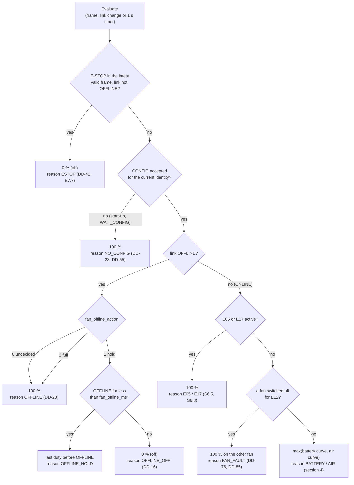
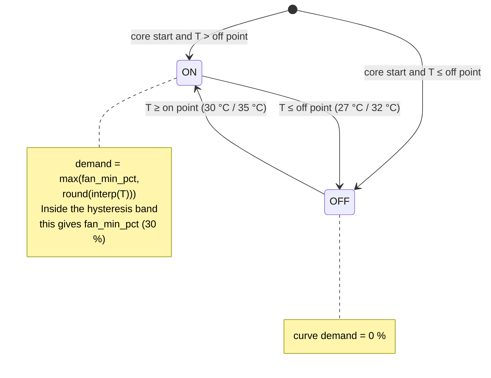
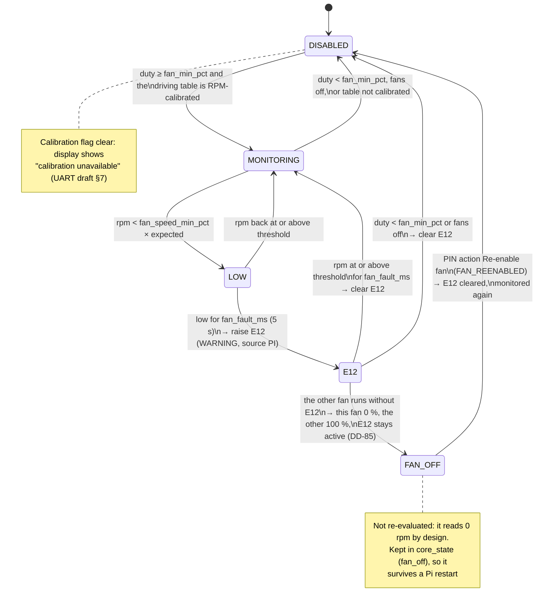

# D4 – Fan control

Status: **Agreed 2026-11-02, except DD-54, still proposed** (DD-51 to DD-55, [decisions.md](decisions.md); DD-76 agreed 2026-10-29: a dead fan is switched off and the other runs at 100 %, details DD-85 agreed 2026-11-02; state FAN_OFF added to the E12 diagram in section 5 on 2026-10-29, DD-85); open points in section 6. Builds on D1 ([architecture.md](architecture.md)): `fan_controller`; D5 ([lifecycle.md](lifecycle.md)): link states, heartbeat liveness (DD-26); D6 ([fault-handling.md](fault-handling.md)): E12 merged into the fault set. Decisions it relies on: DD-16 (OFFLINE behaviour from CONFIG), DD-24 (fan tables only from CONFIG), DD-28 (100 % before CONFIG and with action 0), DD-39 (E12 Pi-only), DD-41 (invalid fields), DD-42 (E-STOP → off).

Requirements: S6.1 (fan control on the Pi), S6.2 (table from the MCU, linear interpolation, ≤ 8 points, duty ± 1 %), S6.3 (max of NTC1 and NTC3 tables), S6.4 (on 30 °C / off 27 °C, ≥ 30 % while on, 100 % at 45 °C), S6.5 (100 % on E05, E-stop overrides), S6.6 (E12 when speed < 70 % of expected for 5 s), S6.7 (hardware fallback, D10), S6.8 (100 % on E17), E7.7 (E-stop → fans off), S8 (fan duty and speed shown), Tables C and C2. UART draft V2 §6–7: CONFIG fan fields and tables.

The Pi controls the fans but the battery's safety does not depend on it (S11.27): the MCU protects on temperature by itself (E05, E17), and the hardware fallback (S6.7) drives the fans when the Pi does not.

## 1. Inputs and outputs

| Input | From | Used for |
|---|---|---|
| `t_cell_c` (NTC1) + validity | TELEMETRY | Battery curve (S6.3, Table C) |
| `t_air_out_c` (NTC3) + validity | TELEMETRY | Air curve (S6.3, Table C2) |
| Fault bitmap: E05, E17 | TELEMETRY and FAULT_UPDATE | Force 100 % (S6.5, S6.8) |
| `state` = E-STOP | TELEMETRY and FAULT_UPDATE | Fans off (DD-42) |
| Link state, identity | `link_supervisor` (D5) | OFFLINE / no-CONFIG behaviour |
| CONFIG fan fields | `mcu config` watch (DD-24) | Tables, hysteresis, `fan_min_pct`, E12 parameters, OFFLINE policy, calibration flags |
| Tach pulses, per fan | Fan controller hardware (D10) | `fan1_rpm`, `fan2_rpm`, E12 |

| Output | To |
|---|---|
| PWM duty 0–100 %, per fan | One fan controller per fan (D10, DD-84); both get the same duty except a dead fan at 0 % (DD-76) |
| `fan_duty_pct`, `fan1_rpm`, `fan2_rpm`, control reason, E12 state, "calibration unavailable" | Live state → display, dashboard, samples (D3) |
| Liveness flag | `uart_tx`: no heartbeat without it (DD-26) |

CONFIG fields used (UART draft V2 §6–7): `battery_fan_on_dC` / `_off_dC` (300 / 270), `air_fan_on_dC` / `_off_dC` (350 / 320), `fan_min_pct` (30), `fan_speed_min_pct` (70), `fan_fault_ms` (5000), `fan_offline_action`, `fan_offline_ms`, `battery_fan_count` / `air_fan_count` (2–8 points), the two 8-point tables (temperature 0.1 °C, duty %, expected RPM) and `config_flags` bit 0 / bit 1 (RPM calibration valid per table).

## 2. When the loop runs

`fan_controller` evaluates once per valid **TELEMETRY** frame (1 s) and immediately on a **FAULT_UPDATE** frame that changes E05, E17 or E-STOP (≤ 100 ms after the MCU reports it), and on every link-state change. A 1 s timer also runs it while no frames arrive, so the OFFLINE timer works. Every evaluation sets the PWM output, even if the duty did not change, and then feeds the liveness flag (DD-51). If setting the PWM fails, the flag is not fed: the heartbeat stops and the MCU raises E11 (S3.8).

## 3. Which rule sets the duty

The first matching rule wins (DD-51):

Notes:

- **E-STOP** comes from the latest valid frame (TELEMETRY or FAULT_UPDATE), also in WAIT_CONFIG. While OFFLINE the Pi cannot know the E-stop state; the hardware E-stop forces the fans off by itself (E7.7), so the Pi follows the OFFLINE rule.
- **E05 / E17** stay forced until the MCU clears the bit. The MCU owns the Table E recovery conditions (E05: ≤ 50 °C for 5 s; E17: NTC3 ≤ 40 °C for 5 s), so the Pi needs no own release logic.
- **Dead fan** (DD-76, DD-85): when E12 is raised for one fan, `fan_controller` sets that fan's controller to 0 % and the other fan's to 100 % (one controller per fan, DD-84). The last running fan is never switched off: with both fans low, both stay on at 100 %. The off state is independent of the duty rules: a switched-off fan stays at 0 % in every row above until "Re-enable fan" (section 5).
- **New identity** (MCU restart or new `config_revision`, D5 §2): the old CONFIG no longer applies, so the fans run at 100 % until the new CONFIG is accepted (DD-55). This is usually 1–2 s.
- The control **reason** is shown on the display next to the duty ("100 % – E05 overheating", "Off – E-STOP", "100 % – waiting for BMS configuration"), so a technician can see why the fans run.

## 4. The two curves (S6.2–S6.4)

Each curve (battery: NTC1 + battery table, air: NTC3 + air table) has its own on/off state (DD-53):

- **Interpolation:** linear between the active points of the table, rounded to the nearest integer, half upward (UART draft §7). Below the first point → the first point's duty; above the last point → the last point's duty (100 % at 45 °C). The > 55 °C and > 45 °C rows of Tables C/C2 are not table points; they are E05/E17 (section 3).
- **Fan demand** = max(battery demand, air demand) (S6.3); the curve with the higher demand is the **driving curve** (used for E12, section 5). On a tie the battery curve drives.
- **Invalid temperature** (validity bit clear, DD-41): that curve demands 100 % (DD-52). A broken sensor must not switch the fans off; the MCU raises its own sensor fault.
- **Start-up state:** a curve starts ON when the temperature is above its off point, so the Pi never stops fans that may have been running inside the hysteresis band before a restart.
- **Example** (Table C, battery 38 °C, air 33 °C, air curve OFF): battery = 30 + (38 − 30) / (40 − 30) × (65 − 30) = 58 %; air = 0 %; duty 58 %.

## 5. Fan speed and E12 (S6.6, DD-39)

- **Measured speed:** tach pulses counted over the last 1 s window, 2 pulses per revolution. Each of the 2 fans has its own tach GPIO and its own copy of the state machine above, so E12 is raised when either fan is low; both speeds are stored (`fan1_rpm`, `fan2_rpm`, DD-58, [fan-hardware.md](fan-hardware.md)).
- **Expected speed** (DD-54): from the driving table's (duty, expected RPM) points, interpolated at the commanded duty. When the duty is forced to 100 %, the 100 % point of the battery table is used (the air table if only that one is calibrated). With the calibration flag of that table clear, E12 is disabled.
- **Spin-up:** after a duty increase the fan needs a few seconds to reach its new speed. `fan_fault_ms` (5 s) covers this (agreed 2026-10-28); verified in the fan test (M5, Miro card D13). If the test fails, the timer will restart on a duty step.
- **Raise / clear:** E12 is a WARNING (no snapshot, DD-21). `fan_controller` puts it into the live fault set; `event_detector` merges it with the MCU bitmap and logs raise and clear like any other code (DD-34), with source `PI`. It is not sent to the MCU (DD-39).
- **Dead fan off** (DD-76, DD-85): the fan with E12 is switched off and the other runs at 100 % (section 3). From then on that fan is in state FAN_OFF: its E12 stays active and is not re-evaluated (it reads 0 rpm by design) until the PIN-protected "Re-enable fan" action on System info (S9.12), logged as `FAN_REENABLED`; then it is monitored again from DISABLED. The off state is kept in `core_state` (`fan_off`), so a Pi restart keeps the fan off.

## 6. Decisions

DD-51, DD-53 and DD-85 agreed 2026-11-02; DD-52 and DD-55 agreed 2026-10-28; DD-76 agreed 2026-10-29; DD-54 proposed 2026-10-28. See [decisions.md](decisions.md):

| ID | Decision |
|---|---|
| DD-51 | `fan_controller` runs on every valid TELEMETRY, on FAULT_UPDATE with an E05/E17/E-STOP change, on link changes and on a 1 s timer; it writes the PWM each run and only then feeds the heartbeat liveness flag. Rule order: E-STOP → no CONFIG → OFFLINE policy → E05/E17 → curves. The rule that set the duty is shown as the control reason. |
| DD-52 | Battery curve from NTC1 (`t_cell_c`), air curve from NTC3 (`t_air_out_c`); an invalid input makes that curve demand 100 %. |
| DD-53 | Each curve has its own hysteresis state; while ON the demand is at least `fan_min_pct`; outside the table the end point's duty is used; a curve starts ON when the temperature is above its off point. |
| DD-54 | Expected RPM for E12 is interpolated at the commanded duty from the driving curve's table; forced 100 % uses the 100 % point. E12 raises after `fan_fault_ms` below `fan_speed_min_pct`, clears after `fan_fault_ms` at or above it or when the fans go below `fan_min_pct`. A fan switched off under DD-85 keeps its E12 (state FAN_OFF) until "Re-enable fan". |
| DD-55 | When the MCU identity changes, the old CONFIG is dropped and fans run at 100 % until the new CONFIG is accepted (extends DD-28). |
| DD-76 | When E12 is raised for one fan, that fan is switched off and the other runs at 100 %. |
| DD-85 | Dead-fan rule after E05/E17 and before the curves; never switch off the last running fan; the fan stays off with E12 active until a PIN-protected "Re-enable fan"; off state kept in `core_state`. |

Open:

- **Fan controller hardware:** proposed in D10 ([fan-hardware.md](fan-hardware.md), DD-56 to DD-61): EMC2101, 2 fans, tach per fan, core-down fallback. Fan model and thermostat part still open there.
- **Production OFFLINE policy:** Pi proposes `fan_offline_action` = 2 (DD-60); waiting for firmware (DD-16, firmware-requests §3).
- **Spin-up vs `fan_fault_ms`:** assumption agreed, test planned (Miro card D13).
- **RPM calibration:** the expected RPM per point must be measured at commissioning (S6.6) and put into `bess_config.h`; until then E12 is disabled.
