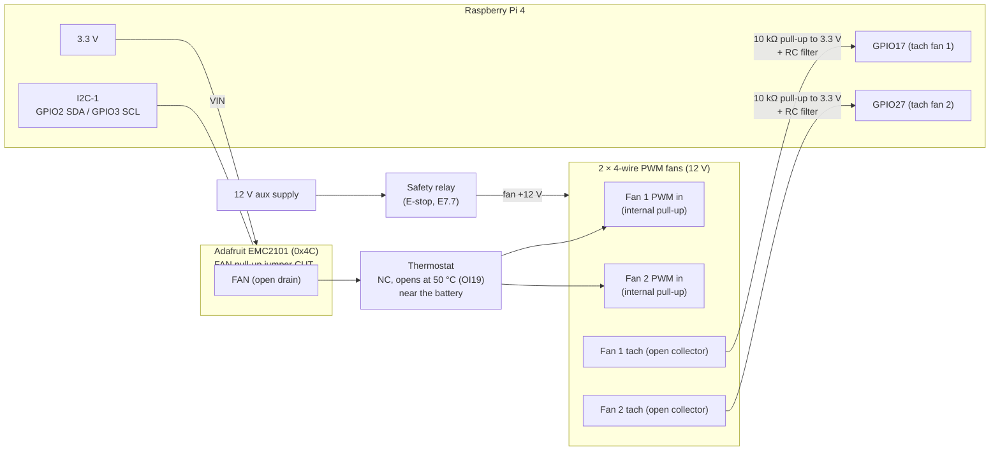
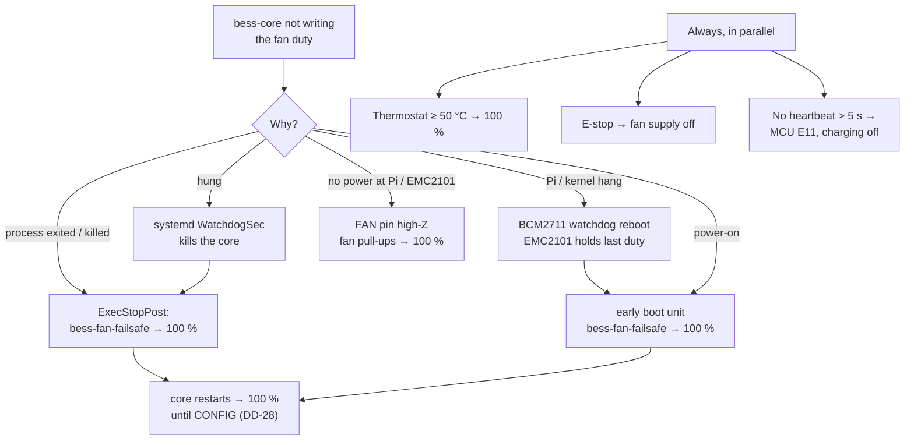

# D10 – Fan controller hardware and fallback

Status: **Proposed 2026-10-29**, to be agreed with electronics and firmware; DD-57 and DD-58 agreed 2026-10-29 (DD-56 to DD-61, [decisions.md](decisions.md)); open points in section 7. Builds on D1 ([architecture.md](architecture.md)): `fan_controller`, DD-17 (crash policy); D4 ([fan-control.md](fan-control.md)): duty rules, E12; D5 ([lifecycle.md](lifecycle.md)): heartbeat, shutdown. Decisions it relies on: DD-16 (OFFLINE policy from CONFIG), DD-17 (systemd restart + watchdog), DD-26 (heartbeat only while fans alive), DD-28 (100 % before CONFIG), DD-42 (E-STOP → off), DD-51 (PWM written each run), DD-54 (E12).

Requirements: S6.1 (Pi + fan controller), S6.2 (duty ± 1 %), S6.6 (E12), S6.7 (hardware fallback: PWM lost → 100 %, thermostat 50 °C TBC), E7.7 (E-stop switches the fan supply), S8 (fan duty and speed, 30 rpm resolution, 2 pulses/rev, 1 s window), M5 (one fan disconnected → E12; PWM lost → 100 %), BOM (2 fans, fan controller module), OI19 (thermostat set point).

Chosen hardware: **Raspberry Pi 4** with an **Adafruit EMC2101 breakout** (Microchip/SMSC EMC2101, [datasheet](https://ww1.microchip.com/downloads/en/DeviceDoc/2101.pdf) rev 2.54) driving **2 × 12 V 4-wire PWM fans**.

## 1. What the EMC2101 does and does not do

| Property (datasheet) | Value | Consequence |
|---|---|---|
| Fan outputs | 1 (FAN pin, open drain, 5 V tolerant) | Both fans share one PWM line, so both always get the same duty (fits the one-curve CONFIG). |
| Tach inputs | 1 (ALERT/TACH pin, shared with ALERT) | Only one fan could be measured; M5 needs both (section 3). |
| SMBus address | 0x4C, fixed | One EMC2101 per I2C bus. |
| PWM resolution / frequency | 2 × PWM_F steps; 360 kHz / (2 × PWM_F × PWM_D) | 62 steps (1.6 %) only up to ≈ 5.8 kHz; at 25 kHz only 14 steps (section 2). |
| Power-up state (EMC2101, not -R) | Fan Setting 00h, non-inverted → **0 %** | Fans at 0 % until the Pi writes the duty (section 4). |
| Communication watchdog | **None** | The last duty is held for ever if the Pi stops writing (section 4). |
| Look-up table mode | 8-point LUT on the external diode | Not used: the Pi controls the duty (S6.1, D4). `PROG` = 1, Fan Setting written directly. |
| TCRIT | External diode above TCRIT → fan full on; default 85 °C, changeable once per power cycle | Optional extra layer (section 7). |

## 2. Wiring and settings

- **PWM line:** the EMC2101 FAN pin sinks; the **fans' own pull-ups** pull the line high. The FAN pull-up jumper on the breakout is **cut**, so a powered-off EMC2101 cannot drag the line low through a pull-up to a dead 3.3 V rail. A cut wire, an open thermostat or an unpowered EMC2101 then all mean "PWM high" = 100 % (S6.7, M5). The fans' pull-up voltage (typically 5 V) is within the FAN pin's 5 V tolerance. Bench test in section 6.
- **Thermostat:** normally closed bimetal switch in series with the PWM line, opening on rising temperature at 50 °C (OI19, TBC). Open → PWM line floats high → 100 %. It needs no power and works with the Pi, the EMC2101 and the I2C bus all dead. It is a signal switch, not in the 12 V path, so it cannot stop the fans.
- **E-stop:** the fans' 12 V comes through the safety relay (E7.7), so the E-stop stops the fans whatever the PWM line does.
- **Tach:** each fan's tach goes to its own Pi GPIO with a 10 kΩ pull-up to 3.3 V (never to 12 V) and a small RC filter against PWM and relay noise (E10). The EMC2101 ALERT/TACH pin is not connected.
- **Pins:** GPIO17 and GPIO27 are a proposal; they avoid I2C-1 (GPIO2/3) and the MCU UART (GPIO14/15). To be confirmed with the wiring diagram.
- **EMC2101 registers** written by `bess-core` at start and after a detected reset (DD-57):

| Register | Value | Meaning |
|---|---|---|
| 0x03 Configuration | 0x00 | ALERT/TACH pin as ALERT (unused), TCRIT locked at default |
| 0x4A Fan Configuration | `PROG` = 1, `POLARITY` = 0, `CLK_OVR` = 1 | Fan Setting written directly, non-inverted, PWM_D used |
| 0x4B Fan Spin-Up | 0x00 | Spin-up bypassed: the Pi sets the duty itself; spin-up time is covered by `fan_fault_ms` (DD-54, D13) |
| 0x4D PWM Frequency | 0x1F (PWM_F = 31) | 62 steps, 1.61 % |
| 0x4E PWM Frequency Divide | 0x01 (PWM_D = 1) | ≈ 5.8 kHz |
| 0x4C Fan Setting | `min(round(duty × 62 / 100), 63)` | Written every run (DD-51); 63 = 100 % |

**Frequency vs accuracy:** the 4-wire fan specification asks for ≈ 25 kHz. On the EMC2101 that gives only 14 steps (7 %), which breaks the S6.2 accuracy of ± 1 %. At 5.8 kHz the duty steps are 1.61 %, so rounding to the nearest step stays within ± 0.81 %. Most 4-wire fans accept a few kHz (the signal goes into the fan's own controller), but some hum or have a non-linear response. Proposal: 5.8 kHz, checked in the bench test with the chosen fan; if the fan misbehaves, 25.7 kHz (PWM_F = 7) and S6.2 relaxed to ± 4 % (DD-57).

## 3. Fan speed (S6.6, S8, M5)

- `fan_controller` counts rising edges on each tach GPIO over a sliding 1 s window (gpio character device edge events). `rpm = pulses × 60 / 2` (2 pulses/rev, S8), which gives exactly the 30 rpm resolution in S8.
- **E12 per fan:** each fan is compared with the expected RPM from DD-54; E12 is raised when **either** fan stays below `fan_speed_min_pct` × expected for `fan_fault_ms`. This is what the M5 test needs (one fan disconnected under LC1 → E12). The E12 event's `detail` names the fan(s) ("fan 2: 0 rpm, expected 1450").
- **Stored value:** both fans are stored separately as `fan1_rpm` and `fan2_rpm` in samples, aggregates, snapshots and events (DD-58, agreed 2026-10-29), so a failing fan shows in the graphs and the CSV. This changes the D2 signal set from 14 to 15 signals (45 aggregate columns); the size impact is negligible.

## 4. Behaviour when the Pi software is not in control (S6.7, DD-17)

The EMC2101 has no watchdog and powers up at 0 %, so the fallback is built from systemd, the wiring and the thermostat (DD-59):

| Situation | What drives the fans | Time without Pi control |
|---|---|---|
| `bess-core` crashes, aborts (`panic = "abort"`) or is killed by systemd `WatchdogSec` | systemd `ExecStopPost=` runs `bess-fan-failsafe`, a small separate binary that writes 100 % (Fan Setting 63) over I2C; systemd restarts the core, which starts at 100 % (NO_CONFIG, DD-28) | < 1 s to 100 % |
| `bess-core` hangs (tasks stuck, process alive) | `WatchdogSec` kills it → as above. A stuck `fan_controller` also stops the heartbeat (DD-26) → MCU E11 → charging off after 5 s | Watchdog time (≈ 10 s) |
| Kernel or Pi hang | BCM2711 hardware watchdog (systemd `RuntimeWatchdogSec`) reboots the Pi. The EMC2101 stays powered and holds the last duty through the reboot, then `bess-core` starts at 100 % | Reboot (≈ 30–60 s); thermostat above 50 °C; MCU E11 stops charging |
| Pi boot from power-off | EMC2101 powers up at **0 %** until `bess-fan-failsafe.service` (early boot unit, before `bess-core`) writes 100 % | Early boot (≈ 10 s); the MCU inhibits charging until the first heartbeat (D5) |
| PIN-protected Pi shutdown (S9.12) / SIGTERM | `bess-core` writes 100 % on exit (and `ExecStopPost` again); after power-off see next row | none |
| Pi or EMC2101 without power | FAN pin high impedance, fans' pull-ups → **100 %** (FAN pull-up jumper cut) | none (bench test) |
| PWM wire broken | Fans' pull-ups → 100 % (M5) | none |
| I2C bus fault | Write fails → liveness not fed → no heartbeat → MCU E11 (DD-51); EMC2101 holds the last duty | Until fixed; thermostat above 50 °C |
| EMC2101 reset (brown-out) | Registers back to defaults (0 %, ≈ 7.8 kHz). `fan_controller` reads back 0x4A, 0x4D and 0x4C after each write; a mismatch re-initialises the chip and logs `FAN_CTRL_RESET` | ≤ 1 s |
| Battery hot while any of the above | Thermostat opens at 50 °C → 100 % | none |
| E-stop | Safety relay removes the fans' 12 V → off, overrides everything (E7.7) | – |

The remaining gap is a hung Pi or a broken I2C bus while the EMC2101 holds a low duty and the battery is below 50 °C. That is acceptable: the MCU stops charging on E11 (the main heat source), the MCU still protects on E05/E17 by itself, and the thermostat takes over above 50 °C.

## 5. OFFLINE policy proposal (DD-16, DD-60)

Proposed production values for the MCU CONFIG: **`fan_offline_action` = 2 (100 % while OFFLINE)**; `fan_offline_ms` unused. Reasons:

- While OFFLINE the Pi has no temperatures, so it cannot run the curves.
- If only the MCU → Pi direction fails, the MCU still receives heartbeats and keeps charging; holding a low duty and then switching off (action 1) would stop the fans during charging.
- It matches the core-down fallback (100 %) and DD-28, so all "Pi does not know" cases behave the same.
- The cost (noise and fan wear while the BMS is switched off on purpose) is small for a lab cabinet.

Sent to firmware in [firmware-requests.md](firmware-requests.md) §3.

## 6. Bench tests

To run with the chosen fans before the M5 thermal tests (results go into this document):

1. PWM line with the FAN jumper cut: duty 0 / 30 / 50 / 100 % → measure the line levels and fan RPM; check the EMC2101 sinks both fans' pull-up current within V_OL ≤ 0.3 V.
2. 5.8 kHz: RPM vs duty is monotonic from 30 to 100 %, no audible hum that matters; otherwise switch to 25.7 kHz (DD-57).
3. Fail-safe: Pi powered off (EMC2101 unpowered), PWM wire pulled, thermostat open (heat gun or replaced by a switch) → fans at full speed each time (S6.7, M5).
4. `kill -9` and `systemctl stop` of `bess-core` at 30 % duty → fans at 100 % within 1 s.
5. Tach: both GPIOs read the same RPM as a handheld tachometer within 30 rpm; disconnect one fan at 100 % → E12 after `fan_fault_ms` naming that fan.
6. Duty 0 %: do the chosen fans stop or keep a minimum speed (open point below)?
7. Spin-up times for D13 can be taken in the same session.

## 7. Decisions

Proposed 2026-10-29; DD-57 and DD-58 agreed 2026-10-29. See [decisions.md](decisions.md):

| ID | Decision |
|---|---|
| DD-56 | Fan controller: Adafruit EMC2101 breakout on Pi 4 I2C-1 (0x4C), host-controlled (`PROG` = 1, LUT not used). Both fans' PWM inputs share the FAN output. The breakout's FAN pull-up jumper is cut so the fans' own pull-ups hold the line high when the EMC2101 is unpowered or the line is broken. NC thermostat (opens at 50 °C, OI19) in series with the PWM line. |
| DD-57 | PWM ≈ 5.8 kHz (PWM_F = 31, PWM_D = 1, `CLK_OVR` = 1), 62 steps, duty rounded to the nearest step (± 0.81 %, S6.2); spin-up bypassed. Fallback if the fan misbehaves at 5.8 kHz: 25.7 kHz with 14 steps and an S6.2 change. Registers read back after each write; a mismatch re-initialises the chip and logs `FAN_CTRL_RESET`. |
| DD-58 | Each fan's tach on its own Pi GPIO (proposed GPIO17, GPIO27; 10 kΩ pull-up to 3.3 V, RC filter), counted over 1 s, 2 pulses/rev. E12 when either fan is low; the event detail names the fan. Both speeds stored and shown (`fan1_rpm`, `fan2_rpm`). |
| DD-59 | Core-down fallback (resolves the open part of DD-17): `bess-fan-failsafe` writes 100 % from `ExecStopPost=` and from an early boot unit; `bess-core` writes 100 % on SIGTERM; BCM2711 hardware watchdog via `RuntimeWatchdogSec`; unpowered EMC2101 → 100 % via the fans' pull-ups; thermostat and MCU E11 cover a hung Pi. |
| DD-60 | Pi proposal to firmware: production `fan_offline_action` = 2 (100 % while OFFLINE), `fan_offline_ms` unused. |
| DD-61 | Fan selection requirements: 12 V 4-wire PWM fan per the 4-wire PC fan specification with an internal pull-up on the PWM input, open-collector tach with 2 pulses/rev, starts reliably from standstill at 30 % duty, works at 5.8 kHz PWM. |

Open:

- **Fan model** (electronics): to meet DD-61. Whether it stops at 0 % duty: Table C says "0 % (off)", but many 4-wire fans keep a minimum speed at 0 %. Either choose a fan that stops at 0 % or accept a slow idle (the duty shown is still 0 %; E12 is disabled below `fan_min_pct` anyway).
- **Thermostat part and set point** (OI19, 50 °C TBC): needs an NC, opening-on-rise signal-level switch with a tolerance that keeps it between 45 °C (full speed) and 55 °C (E05).
- **Firmware answer** on DD-60.
- **Optional TCRIT layer:** a 2N3904 on the breakout's DP/DN near the battery and TCRIT set to 50 °C at start would force 100 % from the EMC2101 itself while the core is down. It only works after the Pi has configured it once after power-up, so it does not replace the thermostat. Not planned unless the thermostat cannot be sourced.
- **Bench test results** (section 6).
