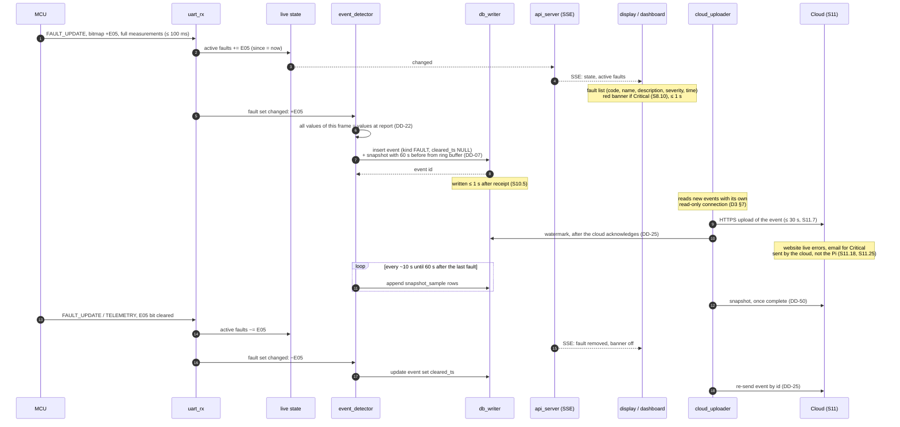
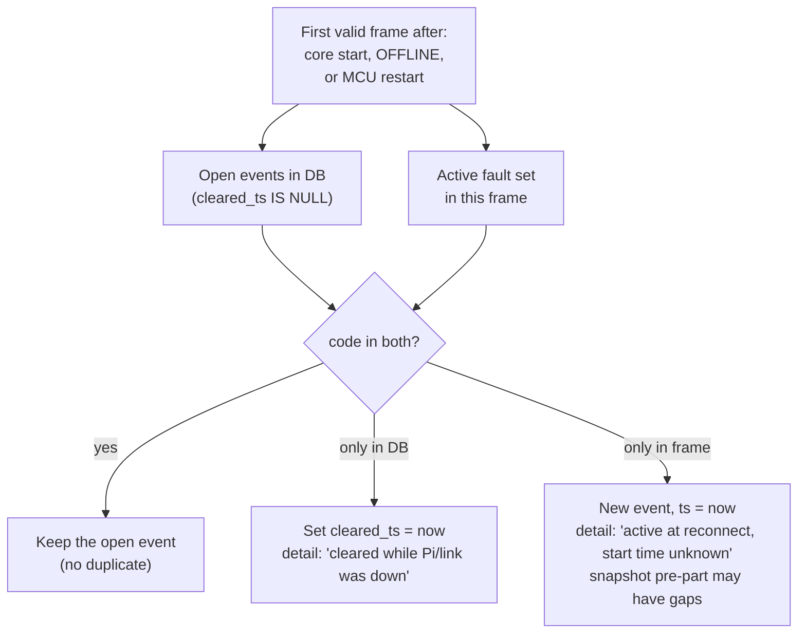
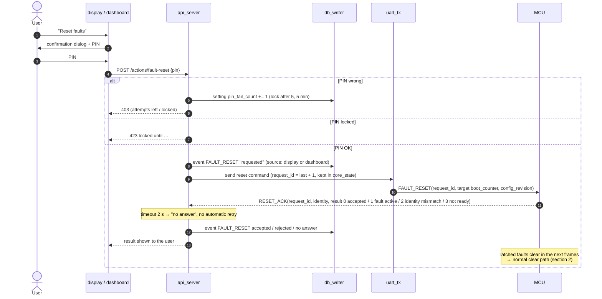

# D6 – Fault and event handling

Status: **Agreed 2026-10-27**, revised the same day for the firmware UART draft (DD-22, DD-34, DD-35, DD-36, DD-38, DD-39); **in review since 2026-10-29** for the decisions proposed that day: DD-66 and DD-68 from the D7 review (lost frames, unknown codes), DD-69 with the error code list (Table A) added to section 1 (faults shown and logged in WAIT_CONFIG), DD-82 and DD-83 from the D8 sweep; also from the D8 sweep DD-81 (agreed 2026-10-29: yellow levels in the TOML file); DD-76 agreed 2026-10-29 (a fan with E12 is switched off, the other runs at 100 %); open points in section 7. Builds on D2 ([database.md](database.md)): DD-07 (two-stage snapshot), DD-20 (one `event` table), DD-21 (snapshot for every FAULT / CRITICAL), DD-22 (trigger + context values), DD-25 (cloud watermark); and D5 ([lifecycle.md](lifecycle.md)): link states, `uart_tx`.

Requirements: S3.6 (explicit reset, rejected while active), S3.7 (LED priority), S4.1 / Table A (codes, one source), S5.8 (faults ≤ 100 ms), S8.10 (active faults, red banner), S8.11 (yellow/red values), S9.9 / S9.10 (fault and event log), S9.12 (PIN), S10.5 (stored ≤ 1 s, never deleted), S10.6 (±60 s snapshot), S11.7 (faults uploaded ≤ 30 s), S11.13–S11.27 (website, email by the cloud, safety never depends on it).

The MCU decides what a fault is. The Pi only records, shows and forwards it (S11.27). The one exception is E12 FAN_FAULT, which the Pi detects itself because it owns the fans (S6).

## 1. Sources

| Source | Kind | How the Pi learns it |
|---|---|---|
| MCU faults E01–E19 (except E12) | FAULT or WARNING | `reported_faults` bitmap (bits 0–18 = E01–E19) in every TELEMETRY (1 s) and in a FAULT_UPDATE ≤ 100 ms after each raise/clear (S5.8, UART draft §4–5) |
| E12 FAN_FAULT | WARNING | `fan_controller` (tach below expected for the set time) |
| Link state changes | SYSTEM / `STATE_CHANGE` | `link_supervisor` (D5) |
| System state changes (IDLE → CHARGING, …) | SYSTEM / `STATE_CHANGE` | State field in telemetry |
| Fault reset requested / accepted / rejected | SYSTEM / `FAULT_RESET` | `api_server` + MCU reply |
| Start-up, shutdown, log gap, FW change, time invalid/adjusted, PIN lock, snapshot deleted | SYSTEM | Core (D5), `maintenance`, `api_server` |

`kind` from Table A severity (DD-33): Warning → `WARNING`; Protection, Latched protection, Critical → `FAULT`. So snapshots (DD-21) are taken for every Protection, Latched and Critical code, except for faults raised in WAIT_CONFIG, where no samples are kept (DD-69, section 3).

### Error codes (Table A)

Copy of requirements Table A (§3.4) with the bit of UART draft V2 §5 (bit = code − 1, E01 = bit 0 … E19 = bit 18), for reading only: the software takes names, descriptions and severities from the one Table A source file (S4.1), which wins on any difference. Trip and recovery limits are in Table E and reach the Pi in CONFIG (DD-24).

Severity (Table A): **Warning** = logged and shown only. **Protection** = charging or discharging stopped, recovers automatically. **Latched protection** = charging or discharging stopped, explicit reset needed after the cause is removed. **Critical** = all outputs off, manual reset needed; shows the red banner (S8.10).

| Code | Name | Severity | Description (Table A) | Kind | Fault log value (DD-35) | Pi side |
|---|---|---|---|---|---|---|
| E01 | OVERVOLTAGE | Protection | A cell voltage is above the maximum cell voltage. Charging stopped. | FAULT + snapshot | highest of `cg1_v`–`cg4_v` | – |
| E02 | UNDERVOLTAGE | Protection | A cell voltage is below the minimum cell voltage. Discharging stopped. | FAULT + snapshot | lowest of `cg1_v`–`cg4_v` | – |
| E03 | OVERCURRENT_CHARGE | Latched protection | Charge current is above the charge current limit. | FAULT + snapshot | `current_a` | Needs a fault reset (section 5) |
| E04 | OVERCURRENT_DISCHARGE | Latched protection | Discharge current is above the discharge current limit. | FAULT + snapshot | `current_a` | Needs a fault reset; also raised by overload, > 5.5 A for 10 s (S3.23) |
| E05 | OVERHEATING | Protection | Battery temperature > 55 °C. Battery cut off, fans 100 %. | FAULT + snapshot | `t_cell_c` | Fans 100 % (S6.5) |
| E06 | UNDERTEMPERATURE | Protection | Battery temperature too low for charging. Charging stopped. | FAULT + snapshot | `t_cell_c` | – |
| E07 | SHORT_CIRCUIT | Critical | Short circuit detected at the output. All outputs off. | FAULT + snapshot | `current_a` | Reset only after the cause is removed and 5 s of valid data (Table E) |
| E08 | ESTOP | Critical | Emergency stop pressed. All outputs off. | FAULT + snapshot | – | State E-STOP: fans off (DD-42); restart by releasing the E-stop and pressing RESET on the safety relay (E7.5) |
| E09 | TEMP_SENSOR_FAULT | Critical | A temperature sensor is open, shorted or implausible. | FAULT + snapshot | – (the stored validity bits show which sensor) | That sensor shows N/A (DD-41); NTC1 or NTC3 → its fan curve 100 % (DD-52) |
| E10 | AFE_COMM_FAULT | Critical | MCU cannot communicate with the cell-monitoring chip (AFE). | FAULT + snapshot | – | Cell voltages and current N/A while their validity bits are clear |
| E11 | PI_COMM_LOST | Warning | No data exchange between MCU and Raspberry Pi. | WARNING | – | The MCU does not hear the Pi for > 5 s (core down or Pi → MCU wire); charging off (S3.8) |
| E12 | FAN_FAULT | Warning | Fan does not reach expected speed. | WARNING | lower of `fan1_rpm`, `fan2_rpm` | Pi-only, `source` = PI (DD-39, section 6); that fan switched off, the other at 100 % (DD-76) |
| E13 | CELL_IMBALANCE | Warning | Voltage difference between cells larger than allowed. | WARNING | highest − lowest of `cg1_v`–`cg4_v` | – (MCU: > 50 mV for 10 s, S3.18) |
| E14 | WATCHDOG_RESET | Warning | MCU was restarted by the watchdog. | WARNING | – | Kept until an accepted fault reset (UART draft §5 proposal) |
| E15 | CONFIG_INVALID | Critical | Battery configuration failed the start-up check. Outputs stay off. | FAULT, no snapshot | – | The MCU sends no valid CONFIG, so the Pi stays in WAIT_CONFIG; shown and logged there, without a snapshot (DD-69) |
| E16 | TERMINAL_OVERTEMP | Critical | Terminal joint (NTC2) too hot, or much hotter than the cells. All outputs off. | FAULT + snapshot | `t_terminal_c` | Latched: needs a fault reset |
| E17 | ENCLOSURE_OVERTEMP | Warning | Air downstream of the battery (NTC3) too hot. Fans 100 %. | WARNING | `t_air_out_c` | Fans 100 % (S6.8) |
| E18 | CHARGE_OVERTEMP | Protection | Battery temperature too high for charging (> 50 °C). Charging stopped. | FAULT + snapshot | `t_cell_c` | – |
| E19 | DISCHARGE_UNDERTEMP | Protection | Battery temperature too low for discharging (< −10 °C). Discharging stopped. | FAULT + snapshot | `t_cell_c` | – |

- Battery temperature is NTC1 (`t_cell_c`, E3.15), so E05, E06, E18 and E19 log `t_cell_c`.
- E03, E04 and E07: the AFE cuts the current within milliseconds, so the current at report is usually near 0 A. The log shows it labelled "at report" (DD-22).
- Bits 19–31 are reserved; a set one is logged as an unknown fault (DD-68).

## 2. Raise and clear

The **complete fault bitmap in each frame is the truth** (DD-34). TELEMETRY and FAULT_UPDATE have the same 38-byte layout, so `event_detector` treats them alike: it processes every frame in arrival order and compares its bitmap with the previous one. A short fault that is raised and cleared between two TELEMETRY frames shows up in two FAULT_UPDATE frames and is logged too. A duplicate or a Pi restart cannot create a double or a missing event. A lost frame can: if the FAULT_UPDATE that raises a short fault is lost, that fault is not logged. The Pi sees lost frames as a jump in the MCU `sequence` and logs `FRAMES_LOST` (DD-66, proposed 2026-10-29). FAULT_UPDATE frames do not go into the 1 Hz sample stream or ring buffer (they do not make old measurements fresh, UART draft §4).

Notes:

- **Stored values** (DD-22): the event row holds all 15 signals, state and validity of the frame that raised it. The UART draft (§9) warns these are the values *at report*, not the exact trip values, so they are labelled that way.
- **Measured value in the fault log** (S9.9, DD-35): the Table A source file gets a `trigger_signal` column per code (listed in section 1, "Error codes") that picks one of the stored values for the log column.
- **Event timestamp** = when the Pi received it (D2). If the clock is not valid, the event waits in RAM (D5 §4).
- **Identity** with every event (DD-36): `fw_version` (from CONFIG), `app_version`, `boot_counter`, `config_revision`.
- **Repeated faults:** every raise is a new event row; nothing is merged locally (the log is never compacted, S10.5). Counting and the email repeat window are cloud features (S11.17, S11.22; DD-83).

## 3. Reconciliation (Pi start-up, reconnect, MCU restart)

This is why the event detector loads all open events from the DB at start-up instead of starting with an empty set (DD-37). It also means a Pi reboot during an active Critical fault does not show the fault as new, and a fault that cleared during the reboot is closed.

While OFFLINE the Pi does not raise or clear anything: it cannot see the MCU, so the last known faults stay shown (D5 §6).

In WAIT_CONFIG it does (DD-69): the fault bitmap needs no CONFIG, and a fault that stops the MCU from sending a valid CONFIG (E15) must still be shown and logged. Measurements stay hidden there (S2.4) and no samples are kept, so FAULT events raised in WAIT_CONFIG get no snapshot, and `fw_version` is NULL until a CONFIG for that identity is received.

## 4. Display rules

| What | Rule |
|---|---|
| Active fault list | Sorted like the LED (S3.7): highest severity first, then lowest code. Shows code, name, description, severity, local time of occurrence (S8.10). |
| Red banner | On every page while any Critical fault is active (S8.10). Stays while OFFLINE (D5 §6). |
| Value colours | Yellow at the warning level, red at the protection limit (S8.11). Value-based, not from events (DD-81): red at the CONFIG protection limit (S2.4), yellow at the S8.11 level. A value can be red while the MCU has not tripped yet (detection delay). CONFIG V2 has no warning levels, so the S8.11 yellow levels are display settings in the Pi's TOML file (DD-81). |
| Fault log page | `event WHERE kind IN ('FAULT','WARNING')`: time, code, name, severity, trigger value + unit, cleared time; filter by severity and date, sort by column (S9.9). |
| Event log page | `event WHERE kind = 'SYSTEM'` (S9.10). |
| Names, descriptions, severities | Only from the generated Table A module (S4.1). The DB stores the code plus `kind` and `severity` for the fault log filters (D2); names and descriptions are looked up when shown, so all screens and the cloud use the same text (DD-82). |

## 5. Fault reset (S3.6, S9.12)

- The Pi never clears a fault itself; only the MCU does, and the fault flags show it.
- "Accepted" means the MCU passed its checks, not that outputs are on; the bitmap shows the actual result within 100 ms.
- `request_id` is nonzero and increases; the last one is stored in `core_state` so a restarted core never reuses an id (UART draft §8 leaves the policy to the Pi).
- Resets with the BMS button are seen only as faults clearing. A reset source field in the telemetry would let the Pi log them too (DD-38, optional, not in the UART draft). The E-stop relay reset stays physical (E7.5).
- The dashboard on the laptop can reset (S9.12); the cloud website cannot (S11.9).

## 6. Events the Pi raises itself

| Event | Condition |
|---|---|
| E12 FAN_FAULT | Fan duty > 0 and RPM < `fan_speed_min_pct` (70 %) of the CONFIG table's expected RPM for `fan_fault_ms` (5 s). Disabled, shown as "fan calibration unavailable", while the CONFIG RPM calibration flag is clear. Cleared when the speed is back. Shown and logged like any Table A code (`source` = PI). Not sent to the MCU (DD-39). The fan with E12 is switched off and the other runs at 100 %; its E12 stays active until the PIN-protected "Re-enable fan" (DD-76, DD-85). |
| STATE_CHANGE | MCU state field changed, or link state changed (D5). |
| PIN_LOCK | 5 wrong PINs. |
| SNAPSHOT_DELETED | Size guard removed old snapshots (DD-23). |
| FRAMES_LOST | Jump in the MCU `sequence` between two valid frames while not OFFLINE; `detail` = number of frames lost; at most 1 per minute (DD-66). |
| Unknown fault | Fault bit 19–31 set in an MCU frame: kind FAULT, `code` = bit + 1, name `UNKNOWN` (DD-68). |

## 7. Decisions

Agreed 2026-10-27, see [decisions.md](decisions.md):

| ID | Decision |
|---|---|
| DD-33 | `kind` follows Table A severity: Warning → `WARNING`; Protection, Latched protection, Critical → `FAULT`. Snapshots for all `FAULT` events (DD-21). |
| DD-34 | (revised) Every TELEMETRY and FAULT_UPDATE carries the complete bitmap; every frame is diffed in arrival order. |
| DD-35 | (revised) Fault log value picked from the stored frame values by a `trigger_signal` column per code; labelled "at report". |
| DD-36 | (revised) `event` has `fw_version`, `app_version`, `boot_counter`, `config_revision`. |
| DD-37 | On core start, reconnect and MCU restart, open events in the DB are reconciled with the first frame's fault set (section 3). Nothing is raised or cleared while OFFLINE. |
| DD-38 | (revised) FAULT_RESET / RESET_ACK per UART draft §8, 2 s, no retry, last `request_id` persisted. |
| DD-39 | (revised) E12 detected only by the Pi with CONFIG parameters; disabled without RPM calibration. |

Proposed 2026-10-29 (DD-66 and DD-68 from the D7 review, [firmware-requests.md](firmware-requests.md) §3, §5; DD-69 from the error code list):

| ID | Decision |
|---|---|
| DD-66 | Lost MCU frames detected from the `sequence` jump: counted (S5.9) and logged as `FRAMES_LOST`, since a lost FAULT_UPDATE can hide a short fault. |
| DD-68 | Reserved telemetry bits and byte 27 ignored; fault bit 19–31 logged as unknown fault (FAULT); unknown `state` shown as unknown and logged. |
| DD-69 | In WAIT_CONFIG, faults are shown and logged as when ONLINE (active fault list, red banner, events); measurements stay hidden, no snapshot, `fw_version` NULL until a CONFIG arrives. Makes E15 visible (section 3). |

Agreed 2026-10-29 (D8 sweep: display and event rules that had no DD):

| ID | Decision |
|---|---|
| DD-81 | Value colours from the value itself: red at the CONFIG protection limit, yellow at the S8.11 warning level; the yellow levels are display settings in the Pi's TOML file (not in CONFIG V2). |

Proposed 2026-10-29 (D8 sweep):

| ID | Decision |
|---|---|
| DD-82 | Events store code, `kind` and `severity`; names and descriptions come from the Table A module when shown. |
| DD-83 | Every fault raise is a new event row; no merging or counting of repeats on the Pi (cloud feature). |

Open:

- ~~Fault message contents~~: defined by the UART draft (DD-34, DD-38).
- ~~E12 set time~~: `fan_fault_ms` from CONFIG.
- Reset source (BMS button) in telemetry: not in the UART draft; optional request to firmware.
- ~~E15 CONFIG_INVALID is never shown~~ (found 2026-10-29): the MCU then sends telemetry but no valid CONFIG (UART draft §8), so the Pi stays in WAIT_CONFIG; faults are now shown and logged there too (DD-69, proposed).
