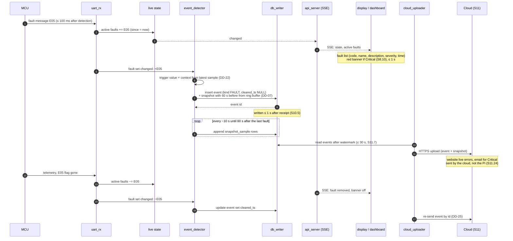
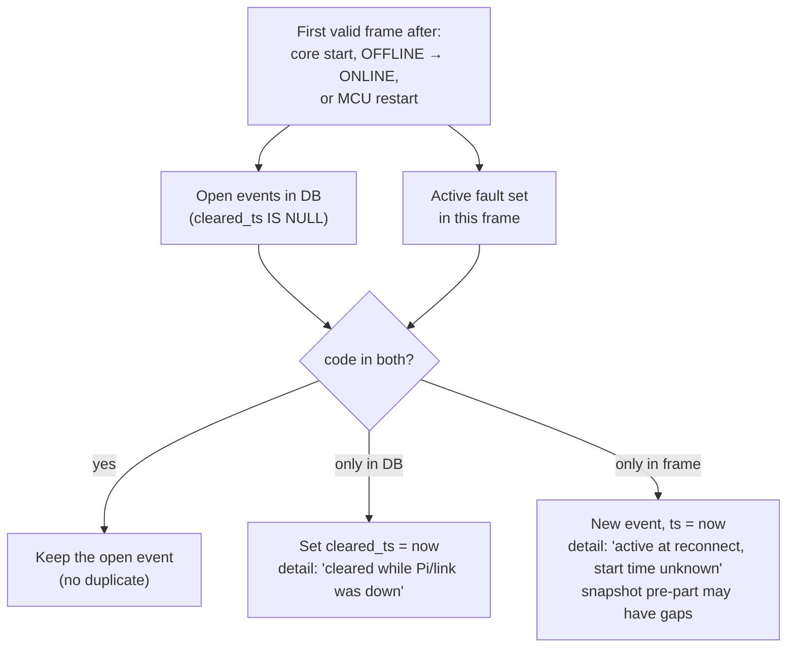
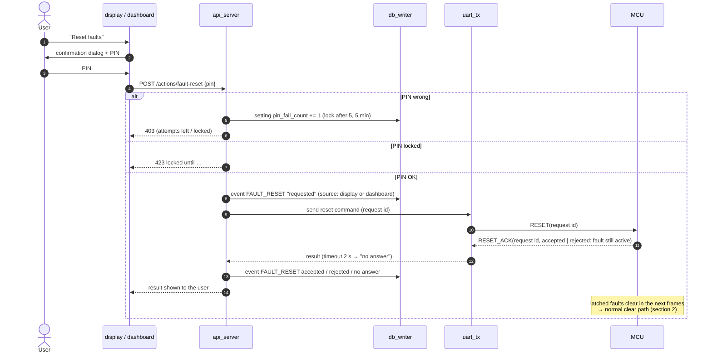

# D6 – Fault and event handling

Status: **Agreed 2026-10-27** (open points in section 7). Builds on D2 ([database.md](database.md)): DD-07 (two-stage snapshot), DD-20 (one `event` table), DD-21 (snapshot for every FAULT / CRITICAL), DD-22 (trigger + context values), DD-25 (cloud watermark); and D5 ([lifecycle.md](lifecycle.md)): link states, `uart_tx`.

Requirements: S3.6 (explicit reset, rejected while active), S3.7 (LED priority), S4.1 / Table A (codes, one source), S5.8 (faults ≤ 100 ms), S8.10 (active faults, red banner), S8.11 (yellow/red values), S9.9 / S9.10 (fault and event log), S9.12 (PIN), S10.5 (stored ≤ 1 s, never deleted), S10.6 (±60 s snapshot), S11.7 (faults uploaded ≤ 30 s), S11.13–S11.27 (website, email by the cloud, safety never depends on it).

The MCU decides what a fault is. The Pi only records, shows and forwards it (S11.27). The one exception is E12 FAN_FAULT, which the Pi detects itself because it owns the fans (S6).

## 1. Sources

| Source | Kind | How the Pi learns it |
|---|---|---|
| MCU faults E01–E19 (except E12) | FAULT or WARNING | Fault flags in every telemetry frame + a fast fault message ≤ 100 ms (S5.8) |
| E12 FAN_FAULT | WARNING | `fan_controller` (tach below expected for the set time) |
| Link state changes | SYSTEM / `STATE_CHANGE` | `link_supervisor` (D5) |
| System state changes (IDLE → CHARGING, …) | SYSTEM / `STATE_CHANGE` | State field in telemetry |
| Fault reset requested / accepted / rejected | SYSTEM / `FAULT_RESET` | `api_server` + MCU reply |
| Start-up, shutdown, log gap, FW change, time invalid/adjusted, PIN lock, snapshot deleted | SYSTEM | Core (D5), `maintenance`, `api_server` |

`kind` from Table A severity (DD-33): Warning → `WARNING`; Protection, Latched protection, Critical → `FAULT`. So snapshots (DD-21) are taken for every Protection, Latched and Critical code.

## 2. Raise and clear

The **fault flags in each frame are the truth**; the fast fault message only makes the Pi react sooner (DD-34). `event_detector` keeps the set of active codes and compares each new set with it. That way a lost fault message, a duplicate, or a Pi restart cannot create a double or a missing event.

Notes:

- **Trigger value** (DD-22, S9.9 "measured value at the moment of the fault"): the Table A source file gets a `trigger_signal` column per code (E01 → highest cell group V, E02 → lowest, E03/E04 → current, E05 → highest battery temp, E16 → `t_terminal_c`, E17 → `t_air_out_c`, E12 → `fan_rpm`, …), and the Pi reads it from the sample received with the fault. If the fault message carries the measured value itself, that is used instead (DD-35, D7).
- **Event timestamp** = when the Pi received it (D2). If the clock is not valid, the event waits in RAM (D5 §4).
- **Firmware and Pi version** with every fault (S1.12): two new columns `fw_version` and `app_version` on `event` (DD-36, small D2 change).
- **Repeated faults:** every raise is a new event row; nothing is merged locally (the log is never compacted, S10.5). Counting and the email repeat window are cloud features (S11.17, S11.22).

## 3. Reconciliation (Pi start-up, reconnect, MCU restart)

This is why the event detector loads all open events from the DB at start-up instead of starting with an empty set (DD-37). It also means a Pi reboot during an active Critical fault does not show the fault as new, and a fault that cleared during the reboot is closed.

While OFFLINE the Pi does not raise or clear anything: it cannot see the MCU, so the last known faults stay shown (D5 §6).

## 4. Display rules

| What | Rule |
|---|---|
| Active fault list | Sorted like the LED (S3.7): highest severity first, then lowest code. Shows code, name, description, severity, local time of occurrence (S8.10). |
| Red banner | On every page while any Critical fault is active (S8.10). Stays while OFFLINE (D5 §6). |
| Value colours | Yellow at the warning level, red at the protection limit (S8.11). Value-based: from the config limits (S2.4), not from events. A value can be red while the MCU has not tripped yet (detection delay). |
| Fault log page | `event WHERE kind IN ('FAULT','WARNING')`: time, code, name, severity, trigger value + unit, cleared time; filter by severity and date, sort by column (S9.9). |
| Event log page | `event WHERE kind = 'SYSTEM'` (S9.10). |
| Names, descriptions, severities | Only from the generated Table A module (S4.1). The DB stores only the code; text is looked up when shown, so all screens and the cloud use the same text. |

## 5. Fault reset (S3.6, S9.12)

- The Pi never clears a fault itself; only the MCU does, and the fault flags show it.
- Resets with the BMS button are seen only as faults clearing. A reset source field in the telemetry would let the Pi log them too (DD-38, optional).
- The dashboard on the laptop can reset (S9.12); the cloud website cannot (S11.9).

## 6. Events the Pi raises itself

| Event | Condition |
|---|---|
| E12 FAN_FAULT | Fan duty > 0 and tach below the expected speed for the set time (S6). Cleared when the speed is back. Shown and logged like any Table A code. Not sent to the MCU (DD-39). |
| STATE_CHANGE | MCU state field changed, or link state changed (D5). |
| PIN_LOCK | 5 wrong PINs. |
| SNAPSHOT_DELETED | Size guard removed old snapshots (DD-23). |

## 7. Decisions

Agreed 2026-10-27, see [decisions.md](decisions.md):

| ID | Decision |
|---|---|
| DD-33 | `kind` follows Table A severity: Warning → `WARNING`; Protection, Latched protection, Critical → `FAULT`. Snapshots for all `FAULT` events (DD-21). |
| DD-34 | Fault flags in every telemetry frame are the truth; the fault message is only a fast path. `event_detector` raises and clears from the difference between consecutive fault sets. |
| DD-35 | Trigger value from a `trigger_signal` column per code in the Table A source file, unless the fault message carries the measured value (D7). |
| DD-36 | `event` gets `fw_version` and `app_version` columns (S1.12). Change to D2. |
| DD-37 | On core start, reconnect and MCU restart, open events in the DB are reconciled with the first frame's fault set (section 3). Nothing is raised or cleared while OFFLINE. |
| DD-38 | Fault reset is a request/acknowledge with a request id and 2 s timeout; requested + result are both logged. Optional: reset source in telemetry so button resets are logged too. |
| DD-39 | E12 is detected, shown and logged only by the Pi; it is not sent to the MCU (no LED blink for E12). |

Open:

- Fault message contents (value, reset ack, boot counter) → D7 / `/protocol`.
- Exact "set time" for E12 detection → S6 / D4.
