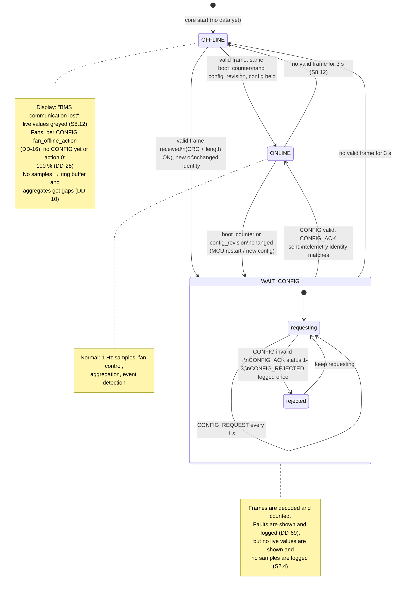
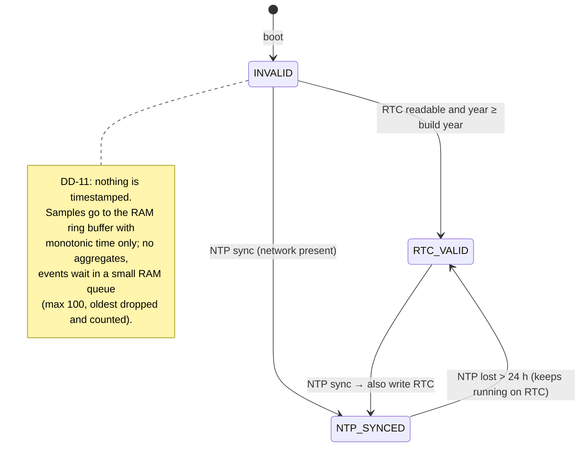
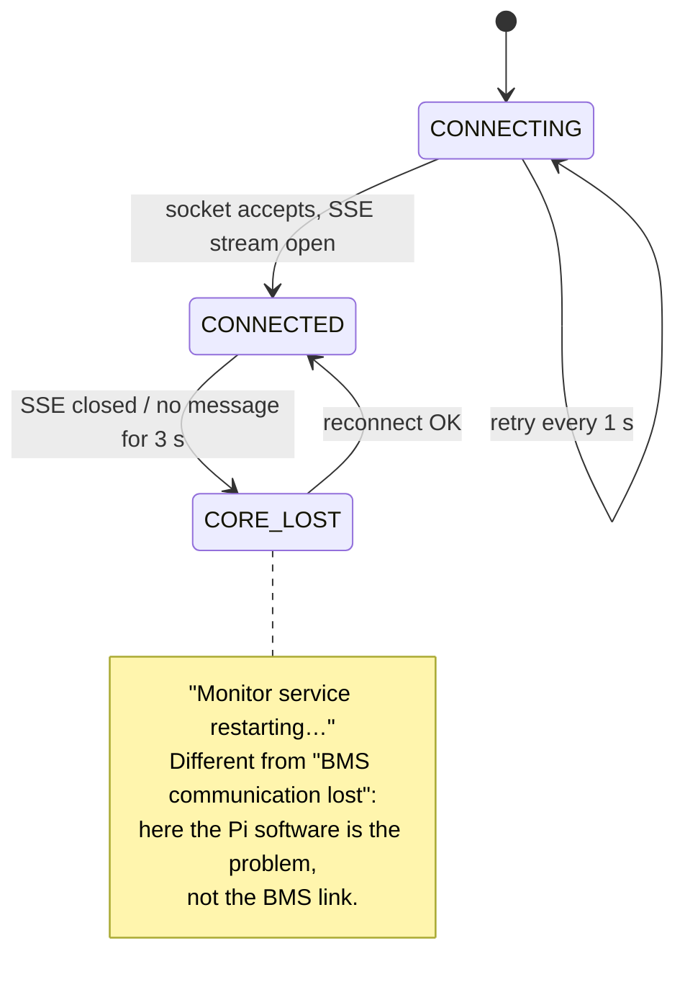

# D5 – Pi app lifecycle and comm-loss state machine

Status: **Agreed 2026-10-27**, revised the same day for the firmware UART draft (DD-16, DD-26, DD-27, DD-28); **in review since 2026-10-29** for the decisions proposed that day: DD-69 (faults shown and logged in WAIT_CONFIG, from the D6 error code list) and DD-77 to DD-80 (D8 sweep: decisions in this document that had no DD; DD-77 revised 2026-11-02 for cage, DD-87); DD-69 and DD-78 to DD-80 agreed 2026-11-02, DD-77 still proposed; open points in section 7. Builds on D1 ([architecture.md](architecture.md)): DD-02 (core + display), DD-11 (no timestamps without a valid clock), DD-13 (RAM buffer not persisted), DD-16 (fans on comm loss), DD-17 (crash policy).

Requirements: S2.4 (config from the MCU before live values), S3.6 (fault reset from the dashboard), S3.8 (MCU reports E11 when Pi frames stop, 5 s), S5.8 (telemetry 1 s, faults ≤ 100 ms), S7.4 (full-screen within 60 s, no login), S8.9 (states + priority), S8.12 ("BMS communication lost" after 3 s), S9.10 (event log), S10.10/S10.16 (UTC, NTP + RTC), S10.17 (logging resumes ≤ 60 s, gap logged).

There are four state machines, each owned by one place:

| Machine | Owner | Section |
|---|---|---|
| Boot / shutdown of the Pi | systemd + core start-up code | 1 |
| BMS link (OFFLINE / WAIT_CONFIG / ONLINE) | `link_supervisor` | 2 |
| Clock validity | `clock_manager` | 4 |
| Display ↔ core connection | `bess-display` | 5 |

## 1. Boot and shutdown

```mermaid
sequenceDiagram
    autonumber
    participant SD as systemd
    participant C as bess-core
    participant DB as SQLite
    participant D as bess-display
    participant M as MCU

    Note over SD: power on (t = 0)
    par core
        SD->>C: start bess-core.service (Type=notify)
        C->>DB: open, run migrations (user_version)
        C->>DB: read core_state.last_alive_ts, open events
        C->>C: clock_manager: RTC read → clock valid?
        C->>C: spawn tasks (uart_rx, uart_tx, link_supervisor, ...)
        C->>DB: event STARTUP + LOG_GAP(last_alive_ts → now)
        C-->>SD: sd_notify READY=1
    and display
        SD->>D: start bess-display.service (no login, full-screen in cage)
        D->>D: show "Starting…"
        D->>C: connect Unix socket (retry every 1 s)
        C-->>D: SSE live stream
    end
    M-->>C: TELEMETRY (1 s, boot_counter + config_revision)
    C->>M: HEARTBEAT (identity 0) + CONFIG_REQUEST, every 1 s
    M-->>C: CONFIG (190 bytes: limits, capacity, fan tables, fw version)
    C->>C: validate (schema, length, ranges, identity = telemetry)
    C->>M: CONFIG_ACK (status 0 accepted)
    C->>DB: mcu_config row, event CONFIG_ACCEPTED
    C->>M: HEARTBEAT (accepted boot_counter + config_revision)
    Note over M: charging no longer inhibited by missing Pi
    Note over D: live values shown after telemetry with the same identity (S2.4); target ≤ 60 s after power on (S7.4)
```

- **Display start (S7.4):** `bess-display.service` runs the egui app full-screen inside the cage compositor as a dedicated user, `WantedBy=multi-user.target` (DD-87). No desktop, no login, no browser (DD-03). It does not wait for the core; it shows "Starting…" until the socket answers (DD-77).
- **Core start:** nothing waits for the network or NTP. Migrations run before any task starts (D2).
- **Log gap (S10.17):** the core writes `core_state.last_alive_ts` every 60 s. At start-up it logs `LOG_GAP` from that time to now, with `detail` = `clean` if the previous run logged `SHUTDOWN`, `crash` if it did not and `last_alive_ts` is under 2 min old (see **Crash** below), else `power loss` (DD-30). If the clock is not valid yet, the event waits in memory (section 4).
- **Shutdown** (SIGTERM, or the PIN-protected "Pi shutdown" action, S9.12, DD-78): stop accepting API actions, write the open 10-min interval as a partial record (its `sample_count` shows it is partial, DD-10), finish any open snapshot with what is available, log `SHUTDOWN`, close the DB, then `systemctl poweroff`. On exit the core sets the fans to 100 %; after power-off they stay at full speed (DD-59). The confirmation dialog warns that the fans will run at full speed until the Pi is started again.
- **Crash:** no `SHUTDOWN` event; systemd restarts the core (DD-17); the next start logs `LOG_GAP` (`detail` = `crash` when `last_alive_ts` is under 2 min old and no `SHUTDOWN` came first).

## 2. BMS link state machine

`link_supervisor` owns the link state. It is published in the live state (`watch`) and drives the display, the fan controller and the event log.



Rules:

- **Timeout** is 3 s from the last *valid* frame, measured on the monotonic clock (not wall time, so NTP steps cannot trigger it). Frames that fail CRC or length are discarded and counted (`comm_error_total`, S5.9); they do not reset the timer.
- **Every transition** logs a `SYSTEM` / `STATE_CHANGE` event (`detail` = `ONLINE -> OFFLINE` etc.). Repeated flapping within 10 s is logged once with a count, so a loose connector cannot flood the event log (DD-80).
- **MCU identity** (UART draft §4): every TELEMETRY and FAULT_UPDATE carries `boot_counter` (changes on every MCU reset) and `config_revision`. A change logs `MCU_RESTART` (or `CONFIG_CHANGE`) and sends the Pi to WAIT_CONFIG. The new CONFIG carries `fw_major.minor.patch`; a change logs `FW_CHANGE` (S7.5, `detail` = `1.2.0 -> 1.3.0`).
- **CONFIG is the only source** of limits, capacity, fan tables, fan fault and offline parameters and the 3 s timeout (`pi_data_timeout_ms`) (S2.4, DD-24). Before the first CONFIG the Pi uses 3 s. The Pi validates it as listed in UART draft §7 (schema 1, exact length, reserved bytes zero, LFP 4S3P, NTC1–3 present, 2–8 strictly increasing fan points, …). The last valid CONFIG is kept in RAM for the running identity and stored in `mcu_config` (DD-43); after a Pi restart it is always re-requested.

## 3. Pi → MCU traffic (`uart_tx`)

`uart_tx` (DD-26) sends these messages, formats per UART draft §8:

| Message | Id, payload | When | Why |
|---|---|---|---|
| HEARTBEAT | 0x10, 8 B: accepted `boot_counter`, `config_revision` (0 before acceptance) | Every 1 s while link + fan task alive | MCU raises E11 and stops charging after > 5 s without an identity-matched heartbeat (S3.8). It also keeps charging inhibited until one arrives. |
| CONFIG_REQUEST | 0x22, empty | Every 1 s in WAIT_CONFIG | Pi may start or restart after the MCU (S2.4). |
| CONFIG_ACK | 0x21, 9 B: identity + status (0 accepted, 1 schema, 2 content, 3 identity) | After validating a CONFIG | MCU knows which config the Pi runs. |
| FAULT_RESET | 0x30, 12 B: `request_id`, target identity | On PIN-confirmed user action | S3.6, S9.12; see D6. |

The heartbeat is sent only while `link_supervisor` and `fan_controller` are alive (each feeds a liveness flag), so a stuck fan task also stops the heartbeat and the MCU falls back to its E11 behaviour. CONFIG_REQUEST and CONFIG_ACK alone do not count as Pi health for the MCU.

## 4. Clock validity (DD-79)



- `clock_manager` reads the time-sync state from `chrony` (no own NTP client). The Pi has no network most of the time, so RTC_VALID is the normal state.
- **Going valid:** queued events are written with the valid time of the moment they are written and `detail` gives their age in seconds (they could not be timestamped exactly). A `TIME_INVALID` event records how long the clock was invalid.
- **Clock step while running** (NTP corrects the RTC by more than 2 s, S10.16): log `TIME_ADJUSTED` with the step size. The aggregator closes the current 10-min interval early and starts the next one on the new time; a backwards step never creates two `agg_10min` rows with the same key (the `INSERT` for an existing `ts` merges by `sample_count`).

## 5. Display ↔ core connection



The SSE stream sends a keep-alive at least every 1 s, so a silent core is noticed within 3 s (DD-77).

## 6. Shown system state (S8.9)

The MCU sends `state` in every frame (UART draft: 0 IDLE, 1 CHARGING, 2 DISCHARGING, 3 FAULT, 4 E-STOP, 5 OFFLINE). The Pi derives OFFLINE itself on link loss. Priority E-STOP > FAULT > OFFLINE > CHARGING/DISCHARGING > IDLE (DD-29):

| Link | Last MCU state | Shown |
|---|---|---|
| ONLINE | any | MCU state |
| WAIT_CONFIG | ESTOP or FAULT | ESTOP / FAULT with "Waiting for BMS configuration"; active faults and the red banner shown, values hidden (DD-69) |
| WAIT_CONFIG | other | OFFLINE ("Waiting for BMS configuration"); active faults shown (DD-69) |
| OFFLINE | ESTOP or FAULT | ESTOP / FAULT (last known), plus the "BMS communication lost" banner and greyed values |
| OFFLINE | other | OFFLINE |

Rationale: if a fault was active when the link dropped, the Pi cannot know it has cleared, so it must not fall back to a calmer state. The critical banner stays (S8.10).

## 7. Decisions

Agreed 2026-10-27, see [decisions.md](decisions.md):

| ID | Decision |
|---|---|
| DD-26 | (revised) `uart_tx`: HEARTBEAT with accepted identity, CONFIG_REQUEST, CONFIG_ACK, FAULT_RESET. The heartbeat stops if `link_supervisor` or `fan_controller` stops. |
| DD-27 | (revised) Link states OFFLINE / WAIT_CONFIG / ONLINE; identity = `boot_counter` + `config_revision` from telemetry; ONLINE only after a validated, acknowledged CONFIG with matching identity. |
| DD-28 | (revised) Before the first CONFIG, and with `fan_offline_action` 0, fans run at 100 %; without a CONFIG they stay at 100 % (no timeout known). |
| DD-29 | Shown state when OFFLINE keeps a last-known ESTOP or FAULT (section 6). |
| DD-30 | `core_state.last_alive_ts` written every 60 s; each start logs `LOG_GAP` with `clean` / `crash` / `power loss`. |
| DD-31 | Clock validity from `chrony`; events from before the clock was valid wait in a RAM queue (max 100); clock steps > 2 s logged as `TIME_ADJUSTED`. |
| DD-32 | Display shows "Monitor service restarting…" when the core is gone, separate from "BMS communication lost". |

Agreed 2026-11-02 (from the D6 error code list, [fault-handling.md](fault-handling.md)):

| ID | Decision |
|---|---|
| DD-69 | In WAIT_CONFIG, faults from valid frames are shown and logged as when ONLINE; measurements stay hidden and are not sampled (S2.4). Makes E15 CONFIG_INVALID visible, since the MCU then sends no valid CONFIG. |

Agreed 2026-11-02, except DD-77, still proposed (D8 sweep: decisions in this document that had no DD):

| ID | Decision |
|---|---|
| DD-77 | `bess-display` runs full-screen inside the cage compositor as a dedicated user (no desktop, no login; revised 2026-11-02, DD-87), does not wait for the core, reconnects every 1 s and shows the core as lost after 3 s without an SSE message (keep-alive at least every 1 s). |
| DD-78 | "Pi shutdown" = clean core stop (partial interval written, open snapshot finished, `SHUTDOWN` logged), then power-off of the Pi only; fans at 100 % until the Pi starts again; no reboot action. |
| DD-79 | Clock valid on an NTP sync (chrony) or with a readable RTC whose year is at least the build year; an NTP sync also sets the RTC. |
| DD-80 | Every link and MCU state change is a `STATE_CHANGE` event; link flapping within 10 s is logged once with a count. |

Open:

- ~~DD-27 field and DD-26 message formats~~: defined by the UART draft (DD-40).
- Does "Pi shutdown" (S9.12) also need a reboot action? Not in the requirements; left out (DD-78).
