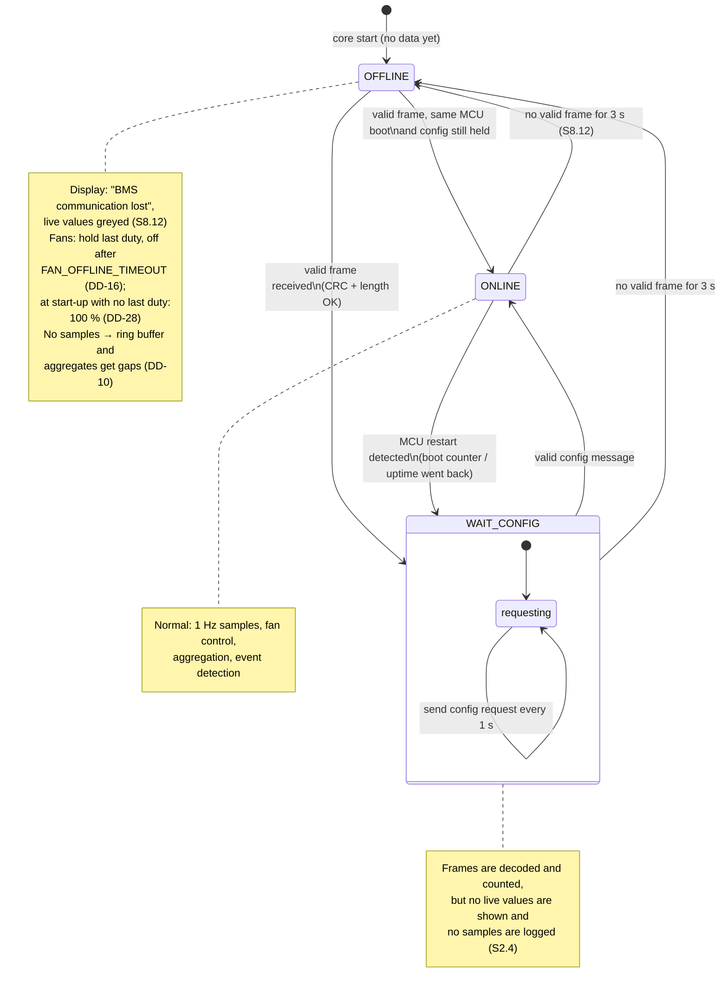
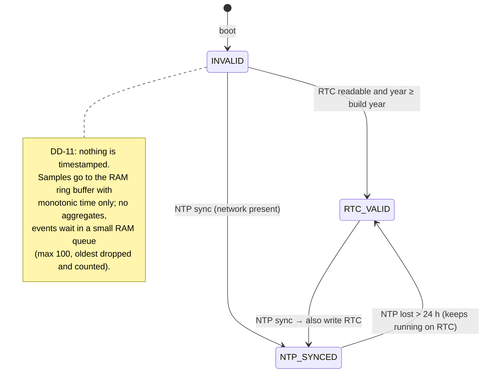
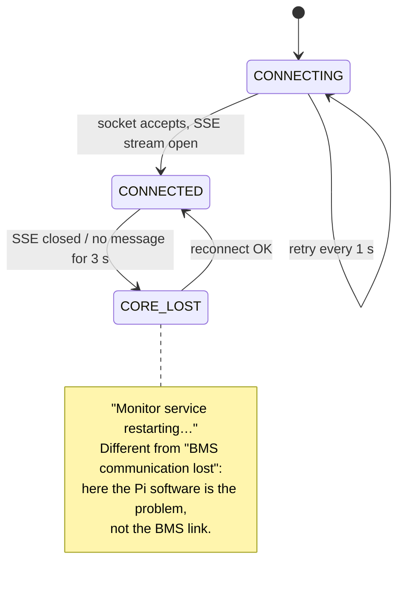

# D5 – Pi app lifecycle and comm-loss state machine

Status: **Agreed 2026-10-27** (open points in section 7). Builds on D1 ([architecture.md](architecture.md)): DD-02 (core + display), DD-11 (no timestamps without a valid clock), DD-13 (RAM buffer not persisted), DD-16 (fans on comm loss), DD-17 (crash policy).

Requirements: S2.4 (config from the MCU before live values), S3.6 (fault reset from the dashboard), S3.8 (MCU reports E11 when Pi frames stop, 5 s), S5.8 (telemetry 1 s, faults ≤ 100 ms), S7.4 (full-screen within 60 s, no login), S8.9 (states + priority), S8.12 ("BMS communication lost" after 3 s), S9.10 (event log), S10.10/S10.16 (UTC, NTP + RTC), S10.17 (logging resumes ≤ 60 s, gap logged).

There are four state machines, each owned by one place:

| Machine | Owner | Section |
|---|---|---|
| Boot / shutdown of the Pi | systemd + core start-up code | 1 |
| BMS link (OFFLINE / WAIT_CONFIG / ONLINE) | `link_supervisor` | 2 |
| Clock validity | `clock_manager` | 4 |
| Display ↔ core connection | `bess-display` | 5 |

## 1. Boot and shutdown

```mermaid
sequenceDiagram
    autonumber
    participant SD as systemd
    participant C as bess-core
    participant DB as SQLite
    participant D as bess-display
    participant M as MCU

    Note over SD: power on (t = 0)
    par core
        SD->>C: start bess-core.service (Type=notify)
        C->>DB: open, run migrations (user_version)
        C->>DB: read core_state.last_alive_ts, open events
        C->>C: clock_manager: RTC read → clock valid?
        C->>C: spawn tasks (uart_rx, uart_tx, link_supervisor, ...)
        C->>DB: event STARTUP + LOG_GAP(last_alive_ts → now)
        C-->>SD: sd_notify READY=1
    and display
        SD->>D: start bess-display.service (no login, KMS full-screen)
        D->>D: show "Starting…"
        D->>C: connect Unix socket (retry every 1 s)
        C-->>D: SSE live stream
    end
    M-->>C: telemetry frames (1 s)
    C->>M: config request (until config received)
    M-->>C: config message (limits, CAP_AH, fan table)
    Note over D: live values shown (S2.4); target ≤ 60 s after power on (S7.4)
```

- **Display start (S7.4):** `bess-display.service` runs the Slint app directly on the KMS/DRM backend as a dedicated user, `WantedBy=multi-user.target`. No desktop, no login, no browser (DD-03). It does not wait for the core; it shows "Starting…" until the socket answers.
- **Core start:** nothing waits for the network or NTP. Migrations run before any task starts (D2).
- **Log gap (S10.17):** the core writes `core_state.last_alive_ts` every 60 s. At start-up it logs `LOG_GAP` from that time to now, with `detail` = `clean` if the previous run logged `SHUTDOWN`, else `power loss`. If the clock is not valid yet, the event waits in memory (section 4).
- **Shutdown** (SIGTERM, or the PIN-protected "Pi shutdown" action, S9.12): stop accepting API actions, write the open 10-min interval as a partial record (its `sample_count` shows it is partial, DD-10), finish any open snapshot with what is available, log `SHUTDOWN`, close the DB, then `systemctl poweroff`. The confirmation dialog warns that fan control stops (fallback per D10).
- **Crash:** no `SHUTDOWN` event; systemd restarts the core (DD-17); the next start logs `LOG_GAP` (`detail` = `crash` when `last_alive_ts` is under 2 min old and no `SHUTDOWN` came first).

## 2. BMS link state machine

`link_supervisor` owns the link state. It is published in the live state (`watch`) and drives the display, the fan controller and the event log.



Rules:

- **Timeout** is 3 s from the last *valid* frame, measured on the monotonic clock (not wall time, so NTP steps cannot trigger it). Frames that fail CRC or length are discarded and counted (`comm_error_total`, S5.9); they do not reset the timer.
- **Every transition** logs a `SYSTEM` / `STATE_CHANGE` event (`detail` = `ONLINE -> OFFLINE` etc.). Repeated flapping within 10 s is logged once with a count, so a loose connector cannot flood the event log.
- **MCU restart detection** needs a field in the telemetry frame: a boot counter or MCU uptime (DD-27). After an MCU restart the Pi re-reads the config (it may have changed) and compares the firmware version; a change logs `FW_CHANGE` (S7.5, `detail` = `1.2.0 -> 1.3.0`).
- **Config message is the only source** of limits, `CAP_AH` and the fan table (S2.4). The Pi keeps the last valid config only in RAM. See DD-24 for what stays in the TOML file (Pi-only settings: DB limits, PIN rules, network, cloud).

## 3. Pi → MCU traffic (`uart_tx`)

D1 only has `uart_rx`. The requirements need the Pi to send too, so D1 gets a `uart_tx` task (DD-26):

| Message | When | Why |
|---|---|---|
| Heartbeat | Every 1 s, as long as the core runs | MCU raises E11 and stops charging after 5 s without Pi frames (S3.8). A hung core stops the heartbeat, and the MCU sees it. |
| Config request | Every 1 s in WAIT_CONFIG | Pi may start or restart after the MCU (S2.4). |
| Fault reset | On PIN-confirmed user action | S3.6, S9.12; see D6. |

The heartbeat is sent by `uart_tx` only while `link_supervisor` and `fan_controller` are alive (each feeds a liveness flag), so a stuck fan task also stops the heartbeat and the MCU falls back to its E11 behaviour. The heartbeat can carry the current fan duty so the MCU knows what the Pi is doing (optional, D7).

## 4. Clock validity



- `clock_manager` reads the time-sync state from `chrony` (no own NTP client). The Pi has no network most of the time, so RTC_VALID is the normal state.
- **Going valid:** queued events are written with the valid time of the moment they are written and `detail` gives their age in seconds (they could not be timestamped exactly). A `TIME_INVALID` event records how long the clock was invalid.
- **Clock step while running** (NTP corrects the RTC by more than 2 s, S10.16): log `TIME_ADJUSTED` with the step size. The aggregator closes the current 10-min interval early and starts the next one on the new time; a backwards step never creates two `agg_10min` rows with the same key (the `INSERT` for an existing `ts` merges by `sample_count`).

## 5. Display ↔ core connection



The SSE stream sends a keep-alive at least every 1 s, so a silent core is noticed within 3 s.

## 6. Shown system state (S8.9)

The MCU sends IDLE, CHARGING, DISCHARGING, FAULT or ESTOP in every frame (S5.7). The Pi adds OFFLINE. Priority E-STOP > FAULT > OFFLINE > CHARGING/DISCHARGING > IDLE (DD-29):

| Link | Last MCU state | Shown |
|---|---|---|
| ONLINE | any | MCU state |
| WAIT_CONFIG | – | OFFLINE ("Waiting for BMS configuration") |
| OFFLINE | ESTOP or FAULT | ESTOP / FAULT (last known), plus the "BMS communication lost" banner and greyed values |
| OFFLINE | other | OFFLINE |

Rationale: if a fault was active when the link dropped, the Pi cannot know it has cleared, so it must not fall back to a calmer state. The critical banner stays (S8.10).

## 7. Decisions

Agreed 2026-10-27, see [decisions.md](decisions.md):

| ID | Decision |
|---|---|
| DD-26 | Add a `uart_tx` task to D1: heartbeat every 1 s, config request in WAIT_CONFIG, fault reset command. The heartbeat stops if `link_supervisor` or `fan_controller` stops, so the MCU's E11 (S3.8) also covers a hung Pi app. |
| DD-27 | Link states OFFLINE / WAIT_CONFIG / ONLINE, 3 s timeout on the monotonic clock from the last valid frame. Telemetry carries an MCU boot counter (or uptime) so the Pi can detect an MCU restart and re-read the config. Protocol field to agree in D7. |
| DD-28 | At start-up before any config is received, fans run at 100 % (no fan table yet, S2.4); after `FAN_OFFLINE_TIMEOUT` without a BMS they turn off (DD-16). |
| DD-29 | Shown state when OFFLINE keeps a last-known ESTOP or FAULT (section 6). |
| DD-30 | `core_state.last_alive_ts` written every 60 s; each start logs `LOG_GAP` with `clean` / `crash` / `power loss`. |
| DD-31 | Clock validity from `chrony`; events from before the clock was valid wait in a RAM queue (max 100); clock steps > 2 s logged as `TIME_ADJUSTED`. |
| DD-32 | Display shows "Monitor service restarting…" when the core is gone, separate from "BMS communication lost". |

Open:

- DD-27 field and DD-26 message formats → D7 (UART sequence diagram) and `/protocol`.
- Does "Pi shutdown" (S9.12) also need a reboot action? Not in the requirements; left out.
