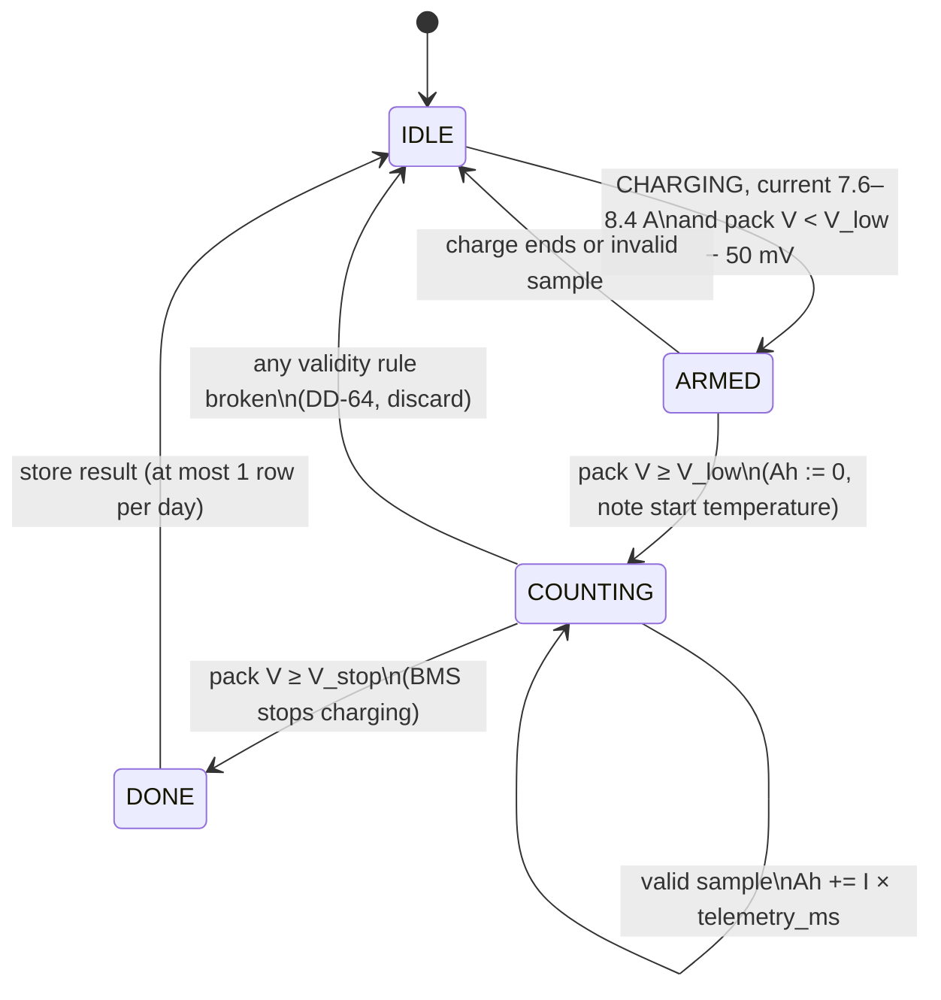

# D11 – State of health (SoH)

Status: **Proposed 2026-10-29**, method chosen 2026-10-29: Ah between a lower voltage point and the BMS charge-stop voltage during the 8 A charge (the options are compared in trade-off T11, [decisions.md](decisions.md)); DD-63 to DD-65, [decisions.md](decisions.md); open points in section 7. Builds on D2 ([database.md](database.md)): `soh` table; D3 ([data-lifecycle.md](data-lifecycle.md)): 1 s samples, Ah integration (DD-46); D9 / [firmware-requests.md](firmware-requests.md) §1. Decisions it relies on: DD-08 (Pi integrates Ah), DD-24 (`CAP_AH` and limits from CONFIG, Pi-only settings in TOML), DD-41 (invalid fields), DD-44 (shown SoC only from the MCU).

Requirements: S10.9 (SoH, stored for the trend graph; wording change proposed in section 6), S8.13 (time to full uses SoH), S9.4 (SoH gauge), S9.11 (System info: measured capacity, baseline reset), Table B (SoH 1 %, updated daily), E1.7 (20–85 % SoC window), E5.2–E5.3 (CC/CV charger, 8.0 A ± 5 %), E5.8 (CHARGING state), E5.9 (charging curve for the selected cells), Table D (9.6 Ah pack, 4S3P).

SoH is information for the user and service; nothing safety-related depends on it (S11.27).

## 1. Why the simple methods do not work

- **Counting is circular.** The MCU SoC is Coulomb counted (S3.15). Ah counted divided by a ΔSoC that is itself Ah counted / `CAP_AH` is always 100 %.
- **LFP resting voltage is flat.** It only shows the SoC below about 20 % and above about 90 %. In between, a few mV is 10 % SoC or more.
- **The battery never goes there.** The BMS keeps it in 20–85 % (E1.7) and stops charging at 85 %, so S10.9's rest points at the readable ends never happen.

## 2. Method (DD-63)

Confirmed 2026-10-29: **the BMS stops charging at 85 % on a pack voltage** (`V_stop`), not on its SoC number. That stop point is a real measurement of the battery, so it can be the top reference.

The charger always charges at the same constant current (8.0 A ± 5 %, E5.3), so the pack voltage follows the same curve every charge. The Pi counts the **Ah charged from a lower voltage point `V_low` up to `V_stop`**. An aged battery holds less, so it takes fewer Ah to get from `V_low` to `V_stop`.

- **`V_stop`:** the BMS charge-stop voltage. Requested in CONFIG so the Pi uses the same value as the MCU (firmware-requests §1); until then a Pi TOML setting.
- **`V_low`:** a pack voltage on the 8 A charge curve, chosen from the measured charging curve (E5.9): where the voltage rises steeply (between the two LFP plateaus), low enough that the window is large (target ≥ 30 % of capacity, ≈ 3 Ah, ≈ 20 min at 8 A) and high enough that a normal charge from the 20 % floor passes it. Pi TOML setting.
- **Measurement:** Ah integrated from the 1 s telemetry the same way as the energy counters (DD-46), from the first sample at or above `V_low` to the first sample at or above `V_stop`.
- **Baseline:** the same window on the new battery at commissioning: the median of the first 3 valid measurements in each temperature band (DD-64), stored in `core_state.soh_baseline`.
- **SoH** = window Ah / baseline window Ah × 100 %. Measured capacity = SoH × `CAP_AH` (System info, time to full).
- Uses only pack voltage, current, temperature and state from TELEMETRY.

Why it is expected to be accurate enough:

- **Current sensor gain error cancels:** the baseline and later measurements use the same sensor at the same current. An offset of 0.05 A is 0.6 % of 8 A.
- **Main error is resistance and temperature:** at 8 A the pack voltage sits about 50–100 mV above the resting voltage, and more when cold or aged. A higher offset moves both crossings earlier, which partly cancels; the rest is limited by comparing within a temperature band only.

Assumption to check: capacity loss spreads over the curve, so the window shrinks in proportion to the total capacity. Usual for LFP but not exact; checked against a full capacity test on the bench when the cells are available.

## 3. When a measurement counts (DD-64)

| Rule | Value (proposal) | Why |
|---|---|---|
| State | CHARGING for the whole window (E5.8), no fault raised | Same charge conditions every time |
| Current | 7.6–8.4 A every sample (8.0 A ± 5 %, E5.3) | CC phase only |
| Arming | Pack voltage below `V_low` − 50 mV while already in CC | The lower crossing must happen under current, not right after the charger starts |
| End | `V_stop` reached and the BMS then stops charging (CHARGING ends within 5 s, no fault) | Confirms the top point is the normal 85 % stop |
| Telemetry | No gap > 2 s, all used fields valid (DD-41), link ONLINE | Missing samples are not counted (DD-46) |
| Temperature | NTC1 (`t_cell_c`) 15–35 °C at the start, change < 5 °C over the window | Resistance depends on temperature |
| Temperature band | 15–25 °C or 25–35 °C (start temperature); compared only with the baseline of the same band | Limits the resistance error |
| Duration | 0.5× to 1.5× the baseline duration | Rejects windows that cannot be real |
| Rate | At most 1 stored result per day (Table B) | One row per day in `soh` |

A core restart inside the window discards it. Passive balancing (E4.1–E4.3) bleeds 50–100 mA from the highest groups (≤ 1.3 % of 8 A), also during the baseline, and is ignored.

A result needs a charge that starts below `V_low`. Charges that only top up from above it give no result; SoH then updates less often.

## 4. What is shown (DD-65)

- **Shown SoH** = median of the last 5 stored results (fewer at the start), rounded to 1 % (Table B). The graph shows every result.
- **Before a baseline exists:** "N/A – being measured"; calculations use 100 %. The first result after the baseline is 100 % by definition.
- **Battery replaced:** a PIN-protected "Reset SoH baseline" action on System info (S9) clears `core_state.soh_baseline` and logs an event; the `soh` history is kept.
- **Time to full (S8.13):** (100 % − SoC) × `CAP_AH` × SoH / |I|.
- **Time to empty (S8.13):** remaining Ah / |I| with remaining Ah = SoC × `CAP_AH` × SoH.

## 5. Data (proposed change to D2)

The `soh` table in [database.md](database.md) was drawn for rest points. Proposed columns:

| Column | Type | Meaning |
|---|---|---|
| `ts` | TEXT PK | UTC, `V_stop` reached |
| `soh_pct` | REAL | Window Ah / baseline × 100 |
| `capacity_ah` | REAL | `soh_pct` / 100 × `CAP_AH` |
| `window_ah` | REAL | Ah charged from `V_low` to `V_stop` |
| `baseline_ah` | REAL | Baseline used (same temperature band) |
| `window_start_ts` | TEXT | UTC, `V_low` crossed |
| `current_a_avg` | REAL | Mean charge current in the window |
| `t_cell_c_start` | REAL | NTC1 at the start |
| `temp_band` | TEXT | `15-25` or `25-35` |
| `v_low_v`, `v_stop_v` | REAL | Window used, so results stay comparable if a value changes |

`soc_start_pct`, `soc_end_pct` and `rest_start_ts` are dropped; `core_state.soh_rest_point` is replaced by `soh_baseline` (JSON: per band the 3 baseline values, their median and the window used). `aggregator` writes the `soh` row (database.md §3).

## 6. Proposed S10.9 wording (for the requirements owner)

Current: *SoH shall be calculated as measured capacity / CAP_AH × 100 %, where measured capacity is the Ah counted between two rest (open-circuit voltage) points at least the set SoC difference apart, divided by that SoC difference. Each SoH value shall be stored so its trend can be shown in the SoH graph.*

Proposed:

> **S10.9** SoH shall be calculated as the Ah charged during a constant-current charge from a set pack voltage up to the BMS charge-stop voltage, divided by the same quantity measured on the new battery at commissioning, × 100 %. A measurement shall only be used when the charge current, cell temperature and telemetry stay within the set conditions for the whole window. Measured capacity shall be shown as SoH × CAP_AH. Each SoH value shall be stored so its trend can be shown in the SoH graph.
>
> Value: lower voltage from the charging curve (E5.9); temperature 15–35 °C; at most once per day. Verification: T (repeat measurements on the same battery within ± 3 % SoH; with one parallel string disconnected, 4S2P, SoH shows about 67 %).

Reason: the current text is circular with the Coulomb-counted SoC (S3.15) and needs rest points outside the 20–85 % window (E1.7) that the BMS never allows.

## 7. Open

- **Firmware:** the value of `V_stop` and whether it is fixed or temperature-compensated; request to send it in CONFIG (firmware-requests §1).
- **Charging curve at 8 A (E5.9)** on the selected cells at about 20 °C and 30 °C, to choose `V_low` and check the window size. The cell datasheet curves give a first estimate.
- **Charging pattern:** do normal charges start low enough (below `V_low`)? If most charges are short top-ups, results are rare.
- **Accuracy:** Table B gives 1 % resolution, no accuracy; proposal ± 3 %.
- **Baseline** on the real battery at commissioning.

## 8. Decisions

Proposed 2026-10-29, see [decisions.md](decisions.md):

| ID | Decision |
|---|---|
| DD-63 | SoH = Ah charged during the 8 A CC charge from `V_low` up to the BMS charge-stop voltage `V_stop` (the 85 % stop is on voltage, confirmed 2026-10-29), divided by the same window on the new battery (baseline per temperature band) × 100 %. Measured capacity = SoH × `CAP_AH`. Replaces the rest-point method of S10.9 (requirements change proposed). |
| DD-64 | A window counts only with CHARGING and 7.6–8.4 A throughout, armed below `V_low` − 50 mV, ended by `V_stop` followed by the BMS stop without a fault, no telemetry gap > 2 s, all fields valid, NTC1 15–35 °C at start and < 5 °C change, duration 0.5–1.5× baseline; compared within its temperature band (15–25 / 25–35 °C); at most 1 result per day. |
| DD-65 | Shown SoH = median of the last 5 results; "N/A – being measured" and 100 % in calculations until a baseline exists; PIN-protected baseline reset on battery replacement; `soh` table columns as in section 5. |
